# Breeze OS（青禾）

一块 480×480 的方屏。主页有翻页时钟和天气，十二个应用可以长按拖动排序。手机连上热点就能传照片、视频和音乐，也可以把问题发给 DeepSeek，由扬声器读出来。

**当前展示：Breeze OS 1.28.0（青禾），原生 ESP-IDF 5.5.6。** 本仓库同时提供最新 IDF 源码、占位符配置与图文教程。[当前功能摘要](docs/WHATS_NEW.md)说明这个版本的能力，[使用指南](docs/USER_GUIDE.md)按步骤讲解日常操作。代码放在哪里，见[版本与源码](#版本与源码)。

> 除下面单列的实机演示录像及其封面外，界面图由当前生产 LVGL 界面在主机上渲染，使用合成数据，不是设备实拍。手机网页图是本地示例页面截图。动图含预览停留，不代表设备帧率，也没有实测最高帧率。[图片来源与版本范围](docs/SCREENSHOTS.md)

## 下载与首次烧录

**[下载 Breeze OS 1.28.0 通用固件包](https://github.com/banli12345/ESP32SmartVoiceBox-public/raw/refs/heads/main/firmware/BreezeOS-1.28.0-Generic.zip)** · **[首次烧录教程](docs/FIRST_FLASH.md)** · [SHA-256 校验](firmware/SHA256SUMS.txt)

新板：解压 ZIP，把 **Factory.bin 从 `0x0`** 烧录；已有本项目 IDF 系统：使用 **OTA.bin**。烧录后在热点网页填写自己的 AI/天气 API 与 Key，无需改源码。包内不含个人凭据或 NVS，完整 SD 字库/素材需另行准备。

**仅适用于本项目接线的 ESP32-S3 N16R8 与配套屏幕。** [屏幕购买参考（淘宝）](https://e.tb.cn/h.jP6J6hg39QyTTQC?tk=JCbl64U5hAT)：不同商家的驱动、初始化参数、RGB 时序和 FPC 定义可能不同，同尺寸屏幕也可能无法显示。换屏前请核对[硬件兼容性](docs/HARDWARE.md#屏幕购买参考与兼容性)。

## 实机演示

<p align="center">
<a href="docs/videos/breeze-os-demo.mp4">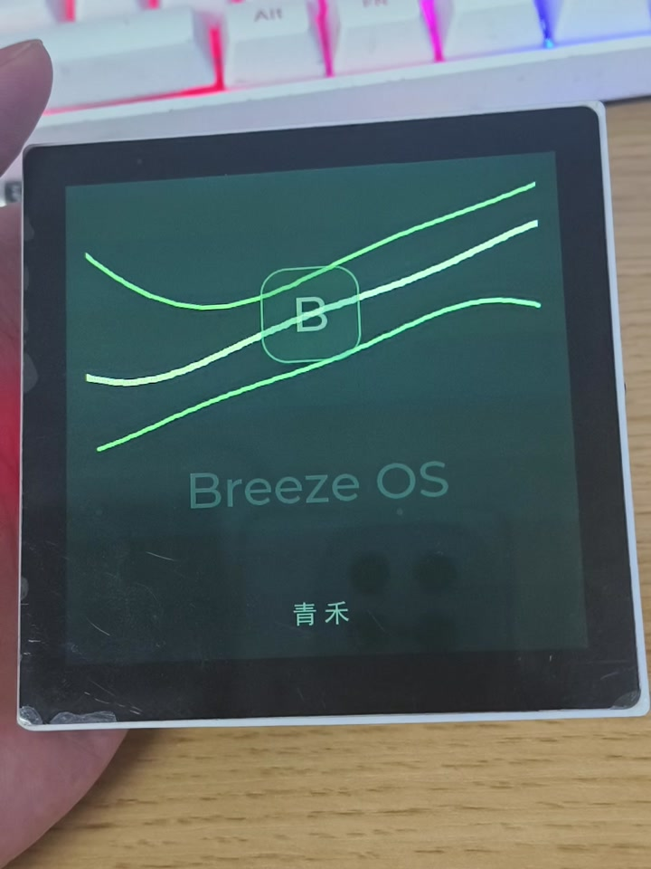</a>
</p>

**[点击观看 / 下载完整演示（MP4，约 6.7 MiB）](docs/videos/breeze-os-demo.mp4)** · [来源与校验信息](docs/videos/manifest.json)

下面继续是主机渲染的界面图与动图，用于说明操作位置。

<p align="center">
<a href="docs/images/boot-breeze.gif">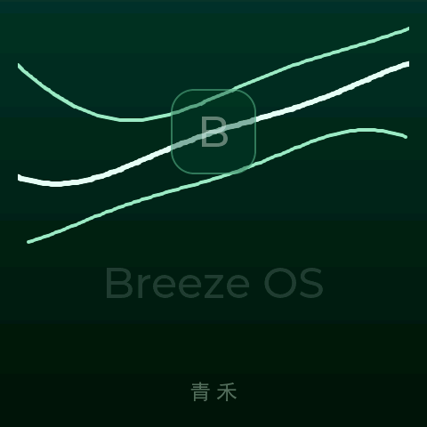</a>
</p>

开机为原生绘制的深翡翠绿画面：圆角 B、风线与底部「青禾」。初始化完成后再播放约 3 秒，不需要 SD 开机字库。动图含预览停留。

图片可点开查看大图；手机阅读时，图组可横向滑动。

当前可在手机热点网页直接配置 AI、天气与生活指数。烧录通用固件后，填自己的接口地址和 Key，分别保存并重启，无需改源码或重新编译；原有 SD 一次性导入仍可用。已有 Key 不回显，留空保留。用户已确认网页保存及重启后各项服务正常。[本版说明](docs/RELEASE_V1.28.0.md)

<p align="center"><a href="docs/images/service-config.png">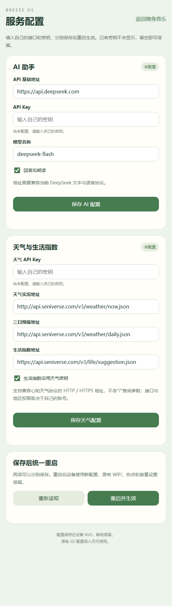</a></p>

**手机连设备热点 → 打开 `http://172.31.42.1/settings` → 分别保存 AI / 天气 → 重启并生效。** 上图来自本版嵌入 HTML 与合成未配置状态，没有真实 Key。[完整配置步骤](docs/API_CONFIGURATION.md)

<table>
<tr><td width="300"><a href="docs/images/weather.png">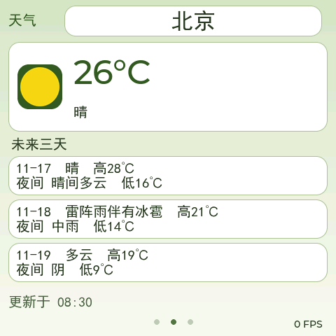</a></td><td width="300"><a href="docs/images/keyboard-space.png">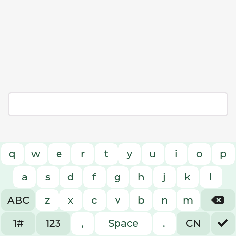</a></td></tr>
<tr><td align="center">天气：大温度与三日预报</td><td align="center">四排键盘：Space 与 CN/EN</td></tr>
</table>

## 三步开始使用

1. 按[首次烧录教程](docs/FIRST_FLASH.md)下载并烧录通用固件，再把字体、图标、壁纸、输入法词库和媒体拷到 SD。背单词还要另拷 `words/cet4.bwv` 与 `fonts/cet4_20.bin`。进入「设置 → WiFi」连接 2.4 GHz 网络。
2. 从顶部下拉快捷栏，短按开关、长按设置，拖动亮度和音量。从两侧向内滑返回。应用内部页面立即切换。
3. 开启设备热点后，手机打开热点设置里的网址，在底部“服务配置”填写自己的 API 与 Key、保存并重启；同一网页还可点歌、传照片/视频或上传更新。设备自己的浏览器保留默认地址即可打开随身音乐页；打开这一页不要求先开热点。

[按图操作 → 使用指南](docs/USER_GUIDE.md) · [当前功能摘要](docs/WHATS_NEW.md) · [硬件连接表与原理图](docs/HARDWARE.md) · [图片来源](docs/SCREENSHOTS.md)

## 桌面与开机

<table>
<tr>
<td width="300"><a href="docs/images/home.png">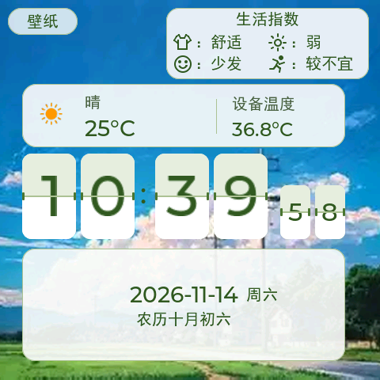</a></td>
<td width="300"><a href="docs/images/apps.png">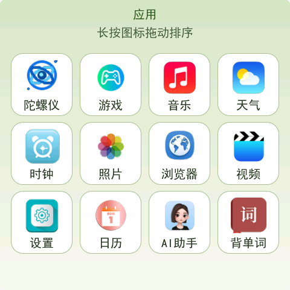</a></td>
</tr>
<tr>
<td align="center">主页</td>
<td align="center">十二个应用，左右滑进入</td>
</tr>
</table>

主页集中了翻页时钟、天气、MPU 芯片温度、日期，以及衣着、紫外线、感冒、运动四枚指数。温度不是室温。

横向翻页。在图标上长按约半秒，拖到新位置后松开，顺序按稳定应用 ID 记住。从左缘或右缘向内滑大约一指宽，松手返回。

<table>
<tr>
<td width="300"><a href="docs/images/clock.gif"></a></td>
<td width="300"><a href="docs/images/depth.gif"></a></td>
</tr>
<tr>
<td align="center">数字翻页，不随桌面切换打断</td>
<td align="center">桌面横滑与进出应用：约 180 ms 层叠侧滑</td>
</tr>
</table>

当前桌面左右切换、打开应用和回到桌面使用约 180 ms 的层叠侧滑和接触阴影。应用内部页面立刻切换。用户已确认切换明显更顺、天气正常。动图只说明过程，不代表设备帧率。

## 背单词与游戏

<table>
<tr>
<td width="300"><a href="docs/images/word-match.png">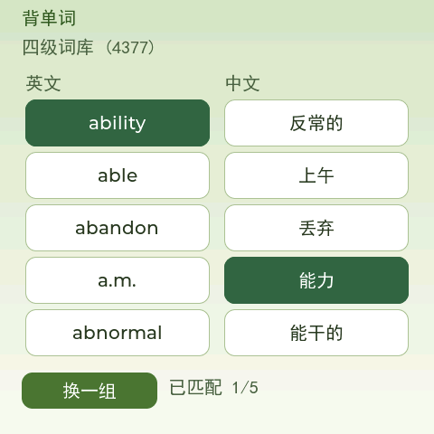</a></td>
<td width="300"><a href="docs/images/games.png">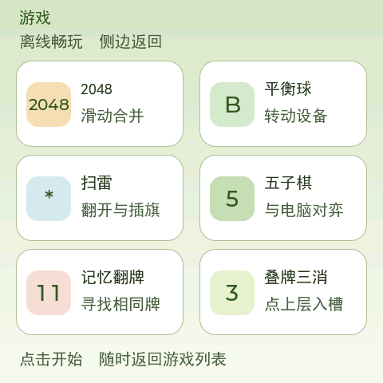</a></td>
</tr>
<tr>
<td align="center">背单词：点左右两列配对</td>
<td align="center">游戏：2048、平衡球、扫雷、五子棋、记忆翻牌、叠牌三消</td>
</tr>
</table>

背单词读取 SD 上 4377 条四级索引词条。每组最多 5 对互不重复的英文和中文，两列各自打乱；点任意一列，正确锁定为绿色，错误短暂变红后可重试。完成一组后记住位置，相同释义会留到下一组。词库和专用字库要单独拷到 SD，OTA 不会装上这两个文件。配对与续学有完整主机测试，设备操作尚未单独确认。

游戏包含六款。五子棋为11×11人机对弈；叠牌三消为100张随机错位、交叠散牌，99张普通牌与1张不占槽的奖励牌。侧边返回先回游戏列表，再回桌面。随机散牌、点击与返回已由用户确认；五子棋完整对局和奖励牌规则有主机检查。游戏图标为固件内的透明渐变手柄，背单词为红色「词」；这两个图标随固件更新，不用上传到 SD。

<table>
<tr><td width="300"><a href="docs/images/gomoku.png">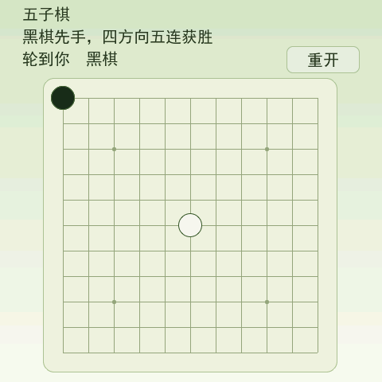</a></td><td width="300"><a href="docs/images/tile-match.png">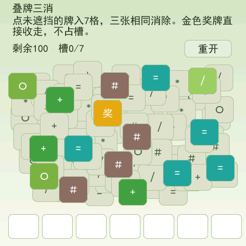</a></td></tr>
<tr><td align="center">五子棋：黑棋先手，与电脑对弈</td><td align="center">叠牌三消：随机错位交叠，7格暂存</td></tr>
</table>

## 浏览器里的随身音乐

<table>
<tr>
<td width="300"><a href="docs/images/browser.png">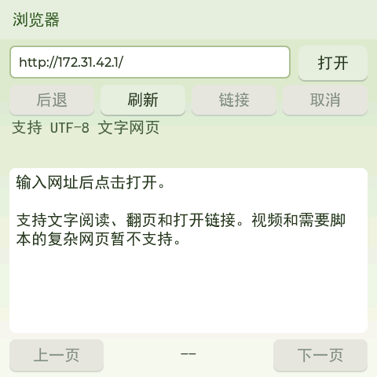</a></td>
<td width="300"><a href="docs/images/native-music.png">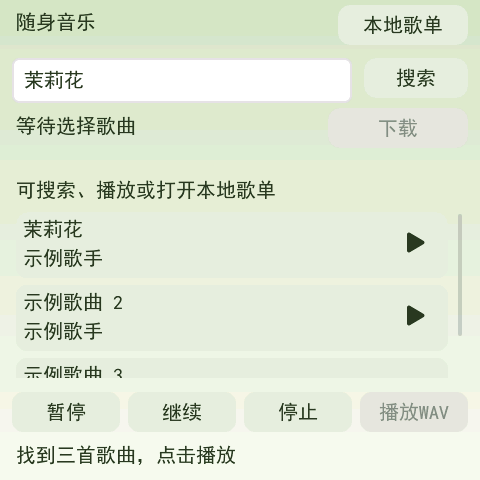</a></td>
</tr>
<tr>
<td align="center">地址栏预填本机网址，没有单独的本机音乐按钮</td>
<td align="center">打开后进入随身音乐</td>
</tr>
</table>

点击歌曲只写可清理的临时 MP3；点“正在播放”右侧的 **下载** 才转存 WAV 和可用歌词。重新搜索其他歌曲后，下载仍对应实际播放或暂停的那首歌。

保留默认 `http://172.31.42.1/`，或输入 `http://127.0.0.1/`、`http://localhost/`，点「打开」进入随身音乐。这一页可以在热点关闭时打开。联网搜索需要设备自己连上能上网的 Wi‑Fi；播放、缓存和保存需要 SD 卡。键盘打开时，侧边返回先收起键盘，再回到浏览器，再回主页。

搜到一首歌只说明目录里有条目。平台公开接口可能对某些原曲返回 HTML 错误页，当前例子是邓紫棋《唯一》（来源 ID 2083785152）。当前会把音源不可用、访问受限、网络失败和 SD 问题分开提示，并保持你选中的版本。可以改选其他有音源的版本，或用手机网页上传自己的 MP3。工程不登录账号，也不提供会员曲库。用户已确认：本机页能打开、能搜索，并播放、保存当时有音源的曲目。新的分类提示尚未在设备上单独确认。

## 快捷与设置

<table>
<tr>
<td width="300"><a href="docs/images/quick-panel.png">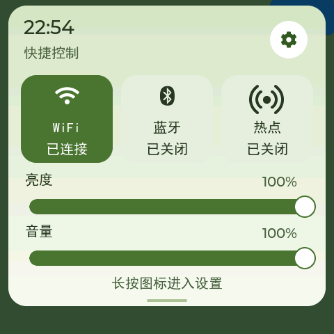</a></td>
<td width="300"><a href="docs/images/settings.png">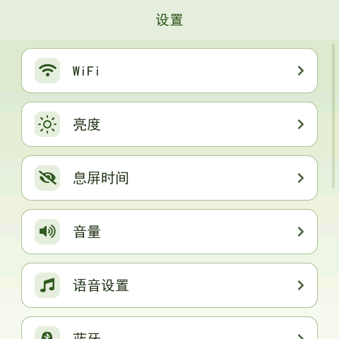</a></td>
</tr>
<tr>
<td align="center">顶部下拉：短按开关，长按进设置</td>
<td align="center">设置按卡片进入</td>
</tr>
<tr>
<td width="300"><a href="docs/images/hotspot-editor.png">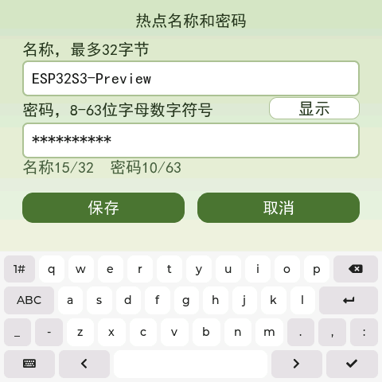</a></td>
<td width="300"><a href="docs/images/screen-timeout.png">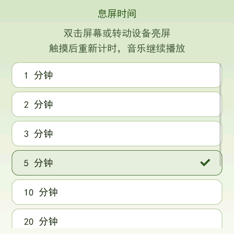</a></td>
</tr>
<tr>
<td align="center">热点名称；密码以掩码显示</td>
<td align="center">息屏时间</td>
</tr>
</table>

亮度、音量直接拖滑条。Wi‑Fi、BLE、热点短按开关。息屏可选 1、2、3、5、10、20、30、60 分钟或永不；摸一下就重新计时。灭屏后双击，或前后/左右倾转设备唤醒；绕屏幕法线的 YAW/Z 不参与判断。亮度回到熄屏前。

热点名称最长 32 个 UTF-8 字节，密码 8–63 位可打印 ASCII。保存后重启仍在。修改后需要重新连接；同名热点改密时，可先忘记旧网络。

系统信息一行显示当前运行版本。当前界面示例为「系统信息 = Breeze OS 1.28.0」，见[图片说明](docs/SCREENSHOTS.md)。

WiFi 最多保存8个成功网络。未连接时自动寻找已保存网络；短按已保存网络切换，首次连接输入密码，长按可重新填写。

<table>
<tr><td width="300"><a href="docs/images/wifi-saved.png">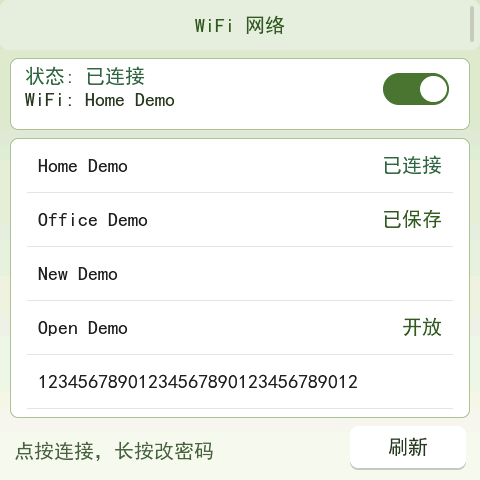</a></td><td width="300"><a href="docs/images/wifi-switching.png">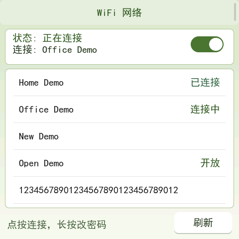</a></td></tr>
<tr><td align="center">保存过的网络</td><td align="center">后台切换网络</td></tr>
</table>

## 日历与生活指数

<table>
<tr>
<td width="300"><a href="docs/images/calendar.png">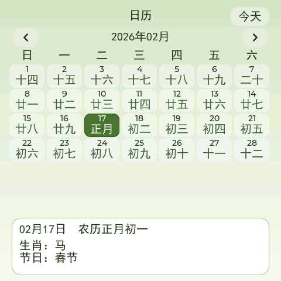</a></td>
<td width="300"><a href="docs/images/home-calendar.png">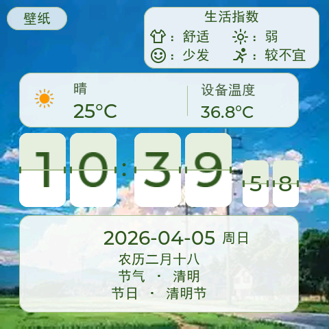</a></td>
</tr>
<tr>
<td align="center">点选日期：农历、生肖、节气、节日</td>
<td align="center">公历、农历、节气、节日集中展示</td>
</tr>
</table>

点击左右按钮或上下滑动切换月份。节气、节日只在有内容时出现。农历离线覆盖 1901–2099，生肖按春节，常见节日会显示，**不是**法定放假表。四项指数来自心知天气，需要在热点网页配置自己的 Key 并联网，按城市和配置来源缓存到当天。

## AI、闹钟与语音

语音先完整缓存到SD再播放，播放、取消或失败后清理临时文件。当前AI状态栏显示缓存大小/百分比、均速与耗时；缓存时临时关闭WiFi Modem省电，结束尝试恢复。WiFi省电本来未生效时，收益可能不明显。

<table>
<tr><td width="300"><a href="docs/images/ai-cache-speed.png">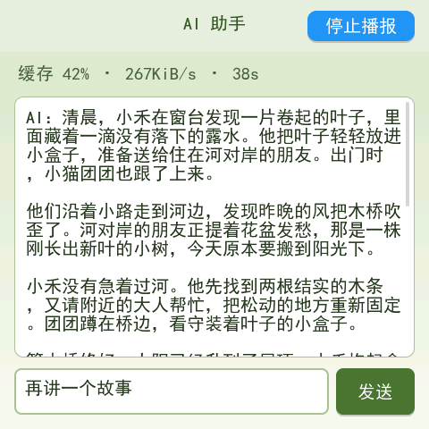</a></td><td width="300"><a href="docs/images/ai-cache-speed-long.png">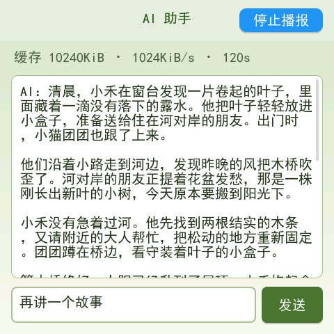</a></td></tr>
<tr><td align="center">百分比、均速和耗时</td><td align="center">未知总长度时显示缓存大小</td></tr>
</table>

以上是当前生产LVGL的主机预览，故事和读数为示意。用户在语音缓存优化时反馈正常，屏上均速约285KiB/s；这是用户读数，含请求等待，不能和旧版串口正文速率直接算提升比例。[缓存与测速说明](docs/MAINTAINING.md#缓存参数与测速)

AI 助手经 HTTPS 直接请求 DeepSeek，文字先显示，完整语音缓存到 SD 后再播放。缓存期间显示进度，可停止；开口前需要等待。临时音频仅占一个文件，结束、取消或失败后清理，开机清理断电残留。播放阶段从本地读音频，不再边下载边等。需要可写的 SD 卡和自己的 API Key。

“设置 → 语音设置”可选女声 stella 或男声 tide，保存后重启保留。长故事可继续追问“继续”，保留上一轮普通问答。用户已确认短句和故事播报恢复正常，以及男女声切换、重启保留。

<table>
<tr><td width="300"><a href="docs/images/voice-female.png">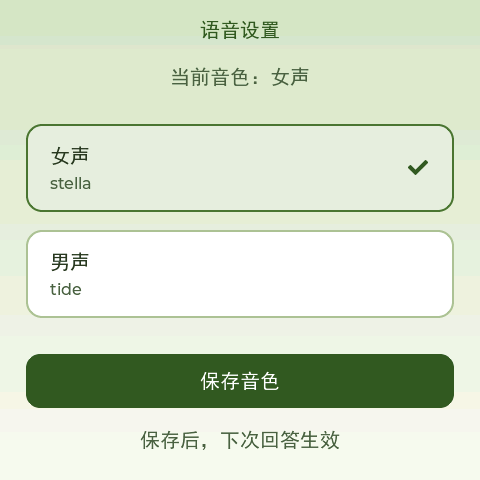</a></td><td width="300"><a href="docs/images/voice-male.png">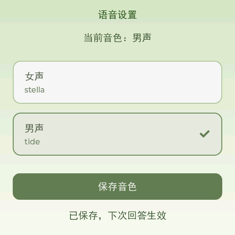</a></td></tr>
<tr><td align="center">女声设置</td><td align="center">男声保存后生效</td></tr>
</table>

“时钟”只保留一个闹钟：选择时分、响铃1～60分钟，以及一次、每天、周一至周五或自选星期。保存后显示距下次提醒还有多久，响铃时自动亮屏，可停止。新设置替换原设置，需要设备保持供电；重启后建议联网校时。

<table>
<tr><td width="300"><a href="docs/images/alarm.png">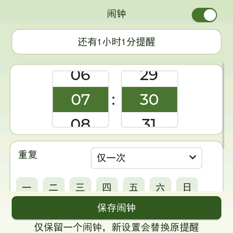</a></td><td width="300"><a href="docs/images/alarm-options.png">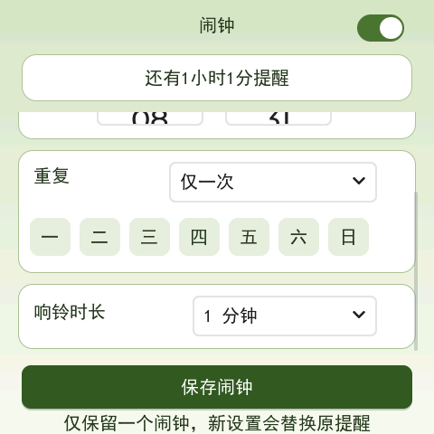</a></td></tr>
<tr><td align="center">单闹钟与倒计时</td><td align="center">向下滑：重复日期和响铃时长</td></tr>
</table>

AI 中输入“帮我设置明天8点的闹钟”，由设备本地解析并等待保存结果；还支持查看、关闭、停止响铃。手动闹钟的倒计时、唤醒、响铃及停止已有实机确认，AI设闹钟仍待单独实机确认。[按步骤使用](docs/USER_GUIDE.md#13-闹钟) · [配置自己的API](docs/API_CONFIGURATION.md)

## 照片与视频管理

<p align="center"><a href="docs/images/media-list.png">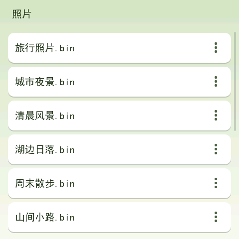</a></p>

<table>
<tr>
<td width="300"><a href="docs/images/media-rename.png">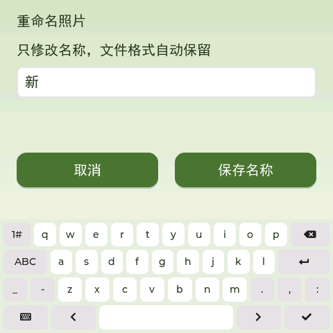</a></td>
<td width="300"><a href="docs/images/media-menu.png">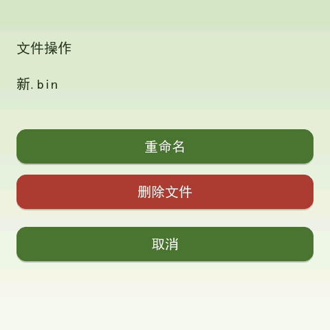</a></td>
</tr>
<tr>
<td align="center">长按后用拼音改名</td>
<td align="center">右侧竖点：确认后删除</td>
</tr>
</table>

列表中短按打开文件，长按进入中文改名；右侧竖点打开文件菜单，确认后删除。 相册内存不足时从 SD 按行读取，退出后释放图片；用户已确认照片及反复打开恢复正常。
视频改名、删除时会同步处理同名音轨，取消操作会保留文件。

## 用手机网页

<table>
<tr>
<td width="300"><a href="docs/images/mobile-music.png">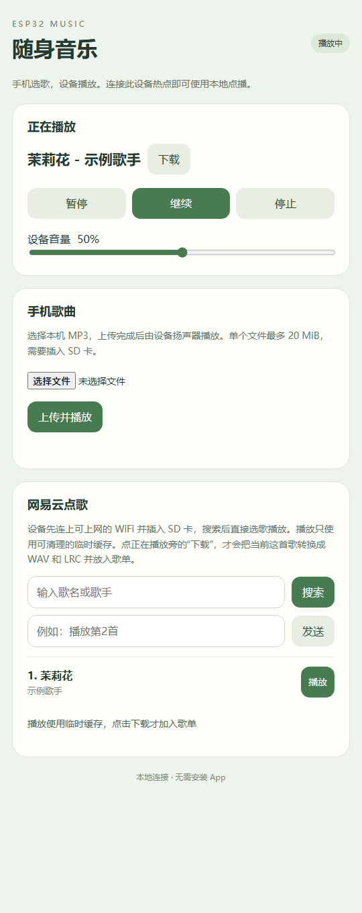</a></td>
<td width="300"><a href="docs/images/mobile-media.jpg">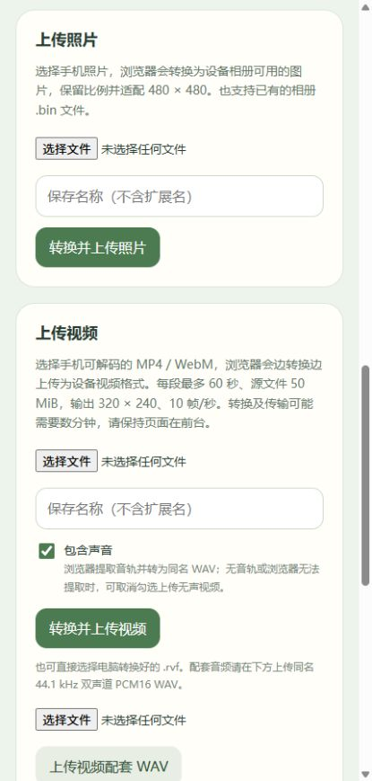</a></td>
</tr>
<tr>
<td align="center">搜索歌曲，点击下载才保存 WAV 和 LRC</td>
<td align="center">照片、视频在浏览器里转换再上传</td>
</tr>
<tr>
<td width="300"><a href="docs/images/mobile-ota.jpg">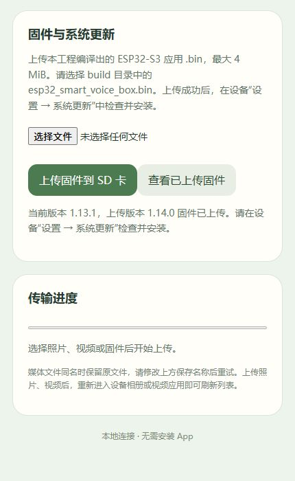</a></td>
<td width="300"><a href="docs/images/ota-ready.png">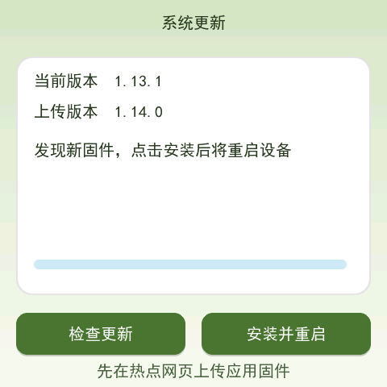</a></td>
</tr>
<tr>
<td align="center">只上传应用 bin，先放到 SD</td>
<td align="center">回到设备上检查并安装（图中为旧示例 1.13.1 → 1.14.0）</td>
</tr>
</table>

手机连接设备热点，打开设置里写的地址。多数情况是 `http://172.31.42.1`；局域网冲突时以屏幕上的地址为准。往本机传文件不需要外网；搜歌和 AI 需要热点已经共享到可上网的 Wi‑Fi。手机网页仍负责媒体和 OTA 上传。设备上的随身音乐是已知本机页面的适配，不运行任意网页脚本，也不播放抖音等网页视频。

系统更新截图是旧示例：当前 1.13.1、候选 1.14.0。它说明检查 SD 候选包的位置，不表示当前固件是 1.14，也不代表提供旧版本固件；当前通用包请使用首页下载入口。

## 硬件与联网条件

[硬件连接表](docs/HARDWARE.md)覆盖屏幕 RGB、触摸、MPU6050、TF、I2S 功放、USB 下载与供电；[完整原理图 PDF（2 页）](hardware/SCH_Schematic2_2026-11-13.pdf)已原样收录。

<table>
<tr>
<td width="440"><a href="docs/images/pcb-3d-2026-11-15.png">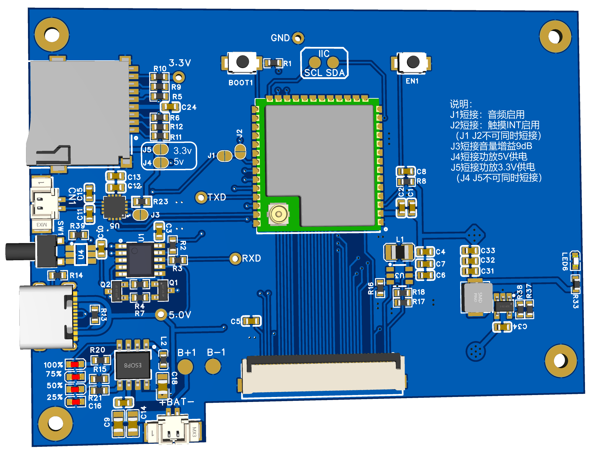</a></td>
<td width="440"><a href="docs/HARDWARE.md#原理图预览">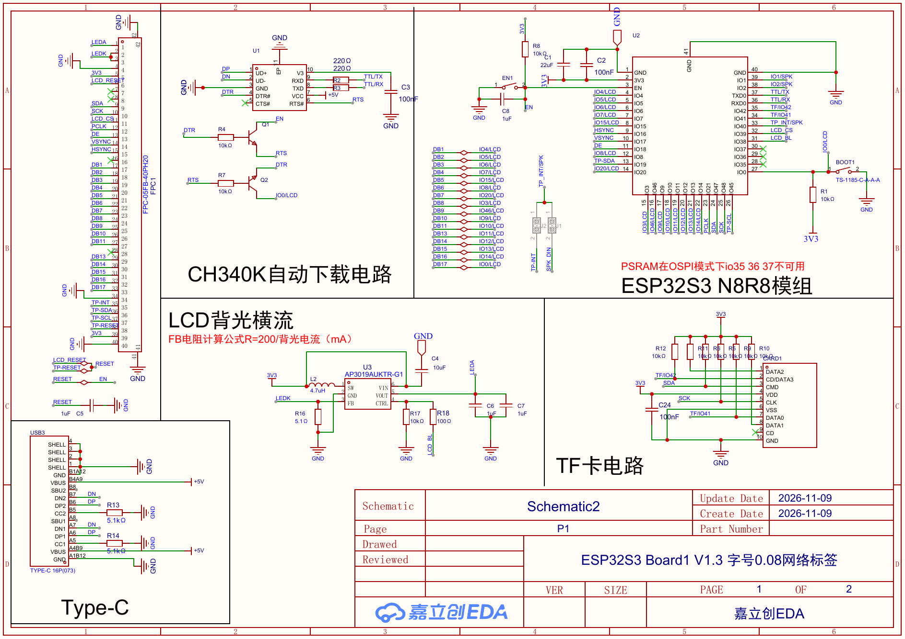</a></td>
</tr>
<tr>
<td align="center">PCB 3D 外观，点击查看大图</td>
<td align="center">原理图 P1，完整两页见硬件说明与 PDF</td>
</tr>
</table>

图纸主控标为 N8R8，当前 IDF 固件使用 N16R8 / 16 MB Flash 配置；U6 稳压型号文字与 3V3 输出网络也有标注矛盾。原图均保留，复刻前请先看[接线前确认事项](docs/HARDWARE.md#接线前先确认)。

| 部分 | 当前搭配 |
| --- | --- |
| 主控与显示 | ESP32-S3 N16R8，ST7701 RGB 480×480，GT911触摸 |
| 姿态与声音 | MPU6050，MAX98357A I2S功放及扬声器 |
| 存储 | FAT32 SD卡，字体、图标、壁纸、输入法词库和媒体独立部署 |
| 在线服务 | 2.4 GHz WiFi；天气/指数使用自己的心知Key，AI使用自己的DeepSeek配置 |
| 本地功能 | 农历日历、SD媒体、游戏，以及热点网页本地上传可离线使用 |

当前 IDF 固件直接请求云端 API，无需之前的 Node/edge-tts 中转服务器。AI 模型在云端，
设备负责提问、显示和播音；热点网页提供媒体传输，并不镜像手机其他 App 的声音。
BLE 提供广播、配对和 GATT，不是 A2DP 蓝牙音箱。

首次部署按[教程](docs/FIRST_FLASH.md)下载当前通用固件，并另备 SD 素材；新板或旧 Arduino 设备先完成配套引导程序与分区迁移，
已使用 IDF 分区的设备可从热点网页上传应用 BIN，再由设备“设置 → 系统更新”安装。
[配置、音乐、文件管理与升级的完整步骤](docs/USER_GUIDE.md)。

## 卡上的文件夹

| 路径 | 放什么 |
|---|---|
| fonts/chinese_16.bin、chinese_20.bin、chinese_32.bin | LVGL v8 BIN，需含全角冒号「：」和间隔号「·」 |
| `fonts/cet4_20.bin` | 背单词专用 20 px 字库，与系统字库分开 |
| `words/cet4.bwv` | 4377 条四级索引词库 |
| `ime/pinyin_full.txt` | 拼音词库 |
| `icons`、`wallpapers` | 原有界面图标与壁纸；游戏和背单词图标已在固件内 |
| `imges` 或 `images` | 相册 BIN（兼容旧目录名） |
| `videos`、`music` | RVF 与 WAV、WAV 与 LRC |

词库文本源、转换工具和两枚内置图标随源码提供；TTF 与生成的 SD BIN 不在仓库中。OTA 只换应用，不会把 `cet4.bwv` 和 `cet4_20.bin` 写进 SD。

## 版本与源码

**这里就是最新 Breeze OS 1.28.0 的原生 ESP-IDF 源码**，根目录以 `CMakeLists.txt` 构建。公开仓库只发布当前快照，不提供旧 Arduino 工程、旧版本标签或历史固件；每次同步后建议重新克隆，先在仓库外保留自己的配置。

```powershell
git clone https://github.com/banli12345/ESP32SmartVoiceBox-public.git
cd ESP32SmartVoiceBox-public
# 在 ESP-IDF 5.5.6 终端中：
idf.py set-target esp32s3
idf.py build
```

心知天气、DeepSeek 的完整接口地址、源码修改位置、自己的 Key 如何填入和导入设备，见 **[API 配置指南](docs/API_CONFIGURATION.md)**。公开示例使用 `YOUR_SENIVERSE_API_KEY`、`YOUR_DEEPSEEK_API_KEY`，不含维护者的实际凭据。AI、天气与生活指数地址和 Key 通过热点网页保存到 NVS，或兼容 SD JSON 一次性导入；修改配置不重新编译。默认通用构建忽略本地 WiFi 默认值，应用不含维护者的实际 Key。

构建得到 `build/esp32_smart_voice_box.bin`，这是 OTA 用的应用镜像；新板首次串口烧录还要配套 bootloader、分区表和初始 OTA 数据。不要对日常 OTA 执行整片擦除。仓库提供[当前通用固件包](firmware/README.md)，完整 SD 资源需另行准备。SD字库补字字符表和生成脚本随源码提供，`~·《》`的部署见[字库说明](docs/FONTS_AND_MOTION.md)。

[编译、烧录与 SD 部署](docs/GETTING_STARTED.md) · [API 配置](docs/API_CONFIGURATION.md) · [图解使用](docs/USER_GUIDE.md) · [当前架构](docs/ESP_IDF_MIGRATION.md) · [公开维护规则](docs/MAINTAINING.md)

## 常见问题

- **没有 Wi‑Fi**：确认是 2.4 GHz，并在设置里保存。
- **网页能开，外网功能不行**：热点只是入口。上游要能上网，搜歌和 AI 才可用；往 SD 传文件不依赖外网。设备浏览器打开随身音乐页本身也不要求热点。
- **搜到了却不能播**：结果列表和可播放音源是两件事。音源不可用、403、网络和 SD 会分开提示。可改选其他版本，或上传自己的 MP3。
- **背单词打不开词**：检查 SD 根目录是否有 `words/cet4.bwv` 和 `fonts/cet4_20.bin`。
- **Key**：在热点网页底部进入“服务配置”，填写自己的地址与 Key，分别保存并重启。已有 Key 不回显，留空保留；也可按[API 配置指南](docs/API_CONFIGURATION.md)使用 SD JSON。
- **缺字**：界面文字检查 SD 上是否为 16/20/32 的 LVGL v8 字体。开机「青禾」使用固件内置小字库。
- **文件好像没换**：同名会保留旧文件，更换保存名称后再传。
- **蓝牙没有声音**：没有经典蓝牙和 A2DP。配对不会把手机音乐送到喇叭。

已确认网页保存、空 Key 保留及重启后天气/生活指数/AI 正常；照片恢复且反复打开正常、双轴判断及双击唤醒正常、缓存后短句和故事播报正常。热点名称/密码保留、媒体上传播放及其他既有功能的确认范围见[图片说明](docs/SCREENSHOTS.md)。完整中文城市设备输入、所有天气状态、显式音乐下载组合、背单词续学等仍待单独确认；主机截图不是实机测试结果。
