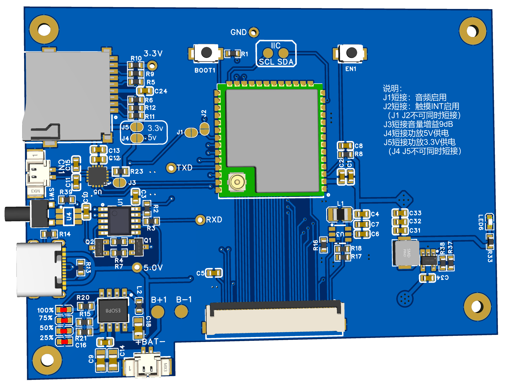
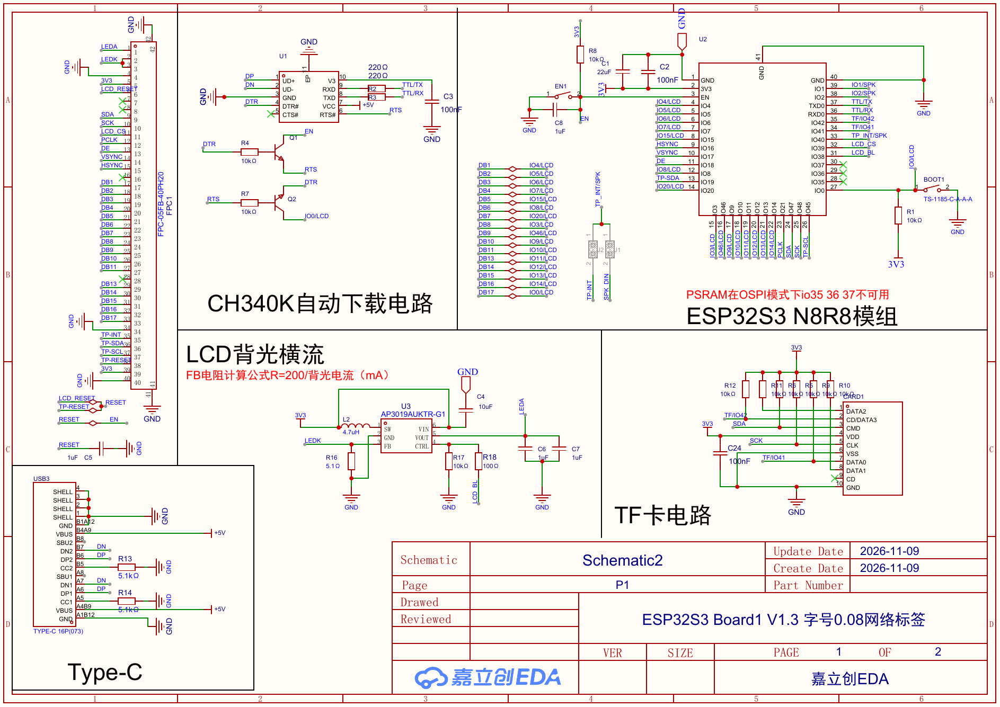
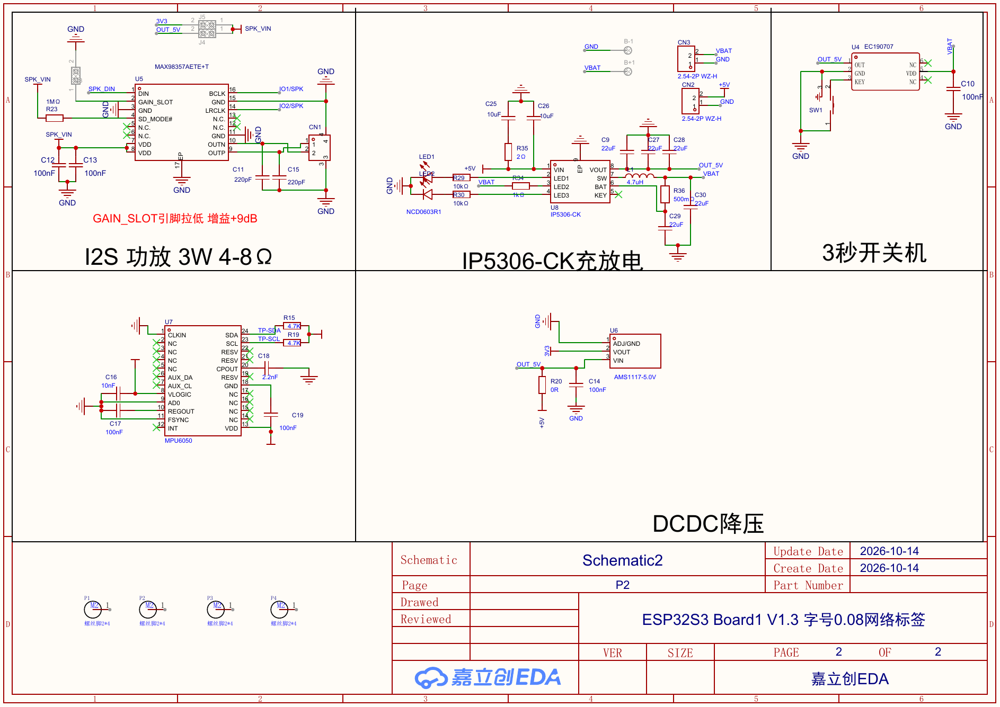

# 硬件与连接表

[返回项目首页](../README.md) · [图解使用指南](USER_GUIDE.md) · [查看 / 下载完整原理图 PDF](../hardware/SCH_Schematic2_2026-11-13.pdf)

这里说明项目当前 Breeze OS 1.28.0 原生 ESP-IDF 使用的接线，并附上项目提供的两页原理图。**表内 GPIO 是 ESP32-S3 的 GPIO 编号，不是模组焊盘号，也不是屏幕插座脚号。** FPC1、CARD1 等脚号单独列出。

原理图保留原始文件，标题为「ESP32S3 Board1 V1.3」。连接表结合图纸与当前 IDF 驱动核对，未对这份图纸重新打板或逐点实测。当前引脚以本仓库 [`src/board_pins.h`](../src/board_pins.h) 和原生驱动为准。

## 屏幕购买参考与兼容性

**[项目提供的屏幕购买参考（淘宝）](https://e.tb.cn/h.jP6J6hg39QyTTQC?tk=JCbl64U5hAT)**。链接由用户提供，此处未核实当前商品详情、库存或具体选项；购买时请确认所选版本与本项目一致。

当前固件按 **ST7701、480×480、RGB 接口、GT911 触摸**及下方 FPC/GPIO 接线初始化。不同商家的屏幕即使外观、尺寸、分辨率相同，也可能使用不同显示/触摸驱动、初始化寄存器、RGB 时序、颜色顺序、背光或 FPC 针脚定义，直接烧录可能黑屏、花屏、偏色或触摸无响应。相同 ST7701 名称也不保证所有面板可共用初始化表。

购买前向商家索取驱动型号、初始化代码、RGB 时序、FPC 定义与供电要求，不能只按“480方屏”选择。当前预编译通用固件用于项目配套硬件，不会自动适配任意商家屏幕。

| 需要适配的内容 | 源码入口 |
| --- | --- |
| RGB GPIO、PCLK、同步/消隐参数、控制信号 | [`src/board_pins.h`](../src/board_pins.h) |
| 屏幕初始化、RGB 面板配置 | [`src/board_lcd.c`](../src/board_lcd.c) |
| GT911 地址、触摸读取与坐标 | [`src/board_touch.c`](../src/board_touch.c) |

换成不同屏幕需核对原理图后修改驱动并重新编译，不能只替换固件文件名。首次烧录步骤见[教程](FIRST_FLASH.md)。

## PCB 外观

这是项目提供的 `3D_PCB1_2026-11-15.png`，按原图收录，是 **PCB 3D 渲染图**。可看到中央主控模组、左侧 TF 卡座与 USB 接口、下方屏幕 FPC 插座、BOOT / EN 按键，以及 IIC、供电和串口测试点。点击可查看原尺寸。

外观图用于认识接口位置，不能替代电气网表。J1 / J2 为音频与触摸中断选择，J3 为功放增益跳线，J4 / J5 为功放电源选择，与原理图的相应连接一致。下文按 PDF 记录电气含义；整板布局、封装与实物连通关系仍需按实际 PCB 文件核对。

## 接线前先确认

| 项目 | 图纸 / 当前方案与注意事项 |
| --- | --- |
| 主控容量 | 图中 U2 写的是 **N8R8**；当前固件配置为 **N16R8，16 MB Flash + 8 MB PSRAM**。按实物确认容量，8 MB Flash 的板子不能直接套用当前 16 MB 分区与整套烧录配置。 |
| 3.3 V 稳压 | P2 的 U6 器件文字是 `AMS1117-5.0V`，但 VOUT 网络标为 `3V3`，两者矛盾。装板前核对实物型号、BOM 和实际输出；不能据此把 5 V 接到 ESP32 的 3V3 脚。原 PDF 未改写。 |
| I/O 电平 | ESP32、触摸、MPU6050 与 TF 信号按 3.3 V 使用；外设与主控共地。屏背光 LEDA / LEDK 走恒流驱动，不是普通 GPIO。 |
| GPIO40 复用 | 触摸 INT 与功放 DIN 通过 J2 / J1 选择。当前使用音频：**接通 J1（SPK_DIN），断开 J2（TP-INT）**。触摸由软件轮询。 |
| J3 功放增益 | J3 接 MAX98357A 的 GAIN_SLOT 与 GND，图纸及 PCB 丝印均标注短接后增益 +9 dB；它不是功放关断跳线。 |
| 功放供电 | J4 接 `OUT_5V`，J5 接 `3V3`，二者均可连到 `SPK_VIN`。按实际供电方案选一处，**不可同时短接 J4、J5**。 |
| 喇叭输出 | 喇叭接 MAX98357A 的 OUTP 与 OUTN 之间，不能把任一输出端接系统 GND。图纸标注扬声器为 4–8 Ω。 |

## 系统由哪些部分组成

| 部分 | 作用 | 图纸位置 |
| --- | --- | --- |
| ESP32-S3 + ST7701 RGB 480×480 | 运行 LVGL、显示界面、WiFi / BLE 和联网服务 | P1：U2、FPC1 |
| GT911 触摸 + MPU6050 | 触摸操作、姿态与转动唤醒；GT911 在屏组件上 | P1：FPC1；P2：U7 |
| TF / microSD | 字体、图标、壁纸、照片、视频、音乐与待安装 OTA 文件 | P1：CARD1 |
| MAX98357A + 扬声器 | 播放音乐、视频声音和 AI 语音 | P2：U5、CN1 |
| Type-C + CH340K | USB 供电、串口下载与日志 | P1：USB3、U1 |
| 供电与背光 | IP5306-CK、电源按键、3.3 V 稳压和背光恒流驱动 | P1：U3；P2：U4、U6、U8 |

该 PDF 没有麦克风采集电路；当前方案不能据此宣称已接入语音输入。ESP32-S3 的 BLE 配对也不能代替 A2DP 蓝牙音箱。

## 屏幕：控制与背光

| 信号 / 图中网络 | ESP32 GPIO | FPC1 脚号 | 用途 |
| --- | --- | --- | --- |
| DE | 18 | 13 | RGB 数据有效 |
| VSYNC | 17 | 14 | 场同步 |
| HSYNC | 16 | 15 | 行同步 |
| PCLK | 21 | 12 | RGB 像素时钟 |
| LCD_CS | 39 | 11 | ST7701 初始化片选 |
| SCK | 48 | 10 | ST7701 初始化时钟，与 TF CLK 复用 |
| SDA | 47 | 9 | ST7701 初始化数据，与 TF CMD 复用 |
| LCD_BL | 38 | — | 背光驱动 U3 的 CTRL，经 R18；不是直接驱动 LEDA |
| LCD_RESET / TP-RESET | 非独立 GPIO，图中连 RESET / EN | 6 / 38 | 屏幕与触摸复位网 |
| LEDA / LEDK | 非 GPIO | 1 / 2、3 | U3 恒流背光输出与回路 |
| 3V3 / GND | 非 GPIO | 5、39 / 4、34、40 | 屏幕与触摸供电、地 |

这里的 `SDA` 是屏幕初始化串行数据 GPIO47；下面的 `TP-SDA` 才是 I2C 数据 GPIO19，接线时不要混淆。

当前驱动通过三线串行命令初始化 ST7701，之后用 RGB 总线持续显示。当前没有单独控制 LCD_RESET / TP-RESET 的 GPIO，屏驱动使用软件复位。

## 屏幕：16 位 RGB 数据线

R0 / G0 / B0 表示各颜色通道的最低位。图纸的 DB 编号有空缺，按下表逐根接，不要把 DB 编号当成 GPIO 编号。

| 固件颜色位 | 图中网络 | ESP32 GPIO | FPC1 脚号 |
| --- | --- | --- | --- |
| B0 | DB1 | 4 | 17 |
| B1 | DB2 | 5 | 18 |
| B2 | DB3 | 6 | 19 |
| B3 | DB4 | 7 | 20 |
| B4 | DB5 | 15 | 21 |
| G0 | DB6 | 8 | 22 |
| G1 | DB7 | 20 | 23 |
| G2 | DB8 | 3 | 24 |
| G3 | DB9 | 46 | 25 |
| G4 | DB10 | 9 | 26 |
| G5 | DB11 | 10 | 27 |
| R0 | DB13 | 11 | 29 |
| R1 | DB14 | 12 | 30 |
| R2 | DB15 | 13 | 31 |
| R3 | DB16 | 14 | 32 |
| R4 | DB17 | 0 | 33 |

FPC1 的 7、8、16、28 脚在图中标为未连接。GPIO0 同时连接 BOOT 键与 LCD R4，进入下载模式后应松开 BOOT，再正常运行显示。

## 触摸与姿态：共享 I2C

| 信号 | ESP32 GPIO | 触摸 FPC1 | MPU6050 U7 |
| --- | --- | --- | --- |
| TP-SDA | 19 | 36 脚 | 24 脚 SDA |
| TP-SCL | 45 | 37 脚 | 23 脚 SCL |
| TP-INT | 40，经 J2；当前不接通 | 35 脚 | — |
| 供电 / 地 | 3V3 / GND | 见屏幕供电表 | 按 P2 电源与去耦网络连接 |

当前 I2C 频率为 100 kHz；GT911 地址为 **0x5D**，MPU6050 地址为 **0x68**（AD0 接地）。P2 的 R15、R19 是 4.7 kΩ 上拉；接外置模块时一并核对已有上拉。

触摸采用轮询，不需要占用 GPIO40 中断；MPU6050 的 INT 在本图中也未使用。息屏是关闭背光并保持触摸、姿态检测运行，因此仍可双击或转动设备唤醒，不是芯片进入深度睡眠。

## TF / microSD：SDMMC 1-bit

| 信号 | ESP32 GPIO | CARD1 脚号 | 当前用途 |
| --- | --- | --- | --- |
| CLK / SCK | 48 | 5 | SDMMC 时钟 |
| CMD / SDA | 47 | 3 | SDMMC 命令 |
| DATA0 | 41 | 7 | 唯一数据线 |
| CD/DATA3 | 42 | 2 | 挂载前拉高，不作为第四条数据线 |
| VDD / VSS | 3V3 / GND | 4 / 6 | 供电与地 |
| DATA1 / DATA2 | 无数据 GPIO，图中上拉 | 8 / 1 | 当前 1-bit 模式不使用 |
| CD / GND | 无卡检测 GPIO / GND | 9 / 10 | 当前不使用插卡检测，10 脚接地 |

GPIO47 / 48 与 LCD 初始化接口共用：**先初始化屏幕，再释放这两根线给 SDMMC**，并保持 LCD_CS（GPIO39）为高。屏幕此后走 RGB 显示，不需要继续发送串行初始化命令。不要在 SDMMC 工作时另行操作屏幕初始化总线，也不要把当前接法描述成独立 SPI SD 接口。

按图保留 TF 上拉与去耦，卡使用 FAT32。插卡和准备素材的步骤见[使用指南：开机前准备](USER_GUIDE.md#1-开机前准备)。

## 声音：I2S 功放

| 信号 | ESP32 GPIO / 电源 | MAX98357A U5 / 接口 |
| --- | --- | --- |
| BCLK | 1 | 16 脚 BCLK |
| LRCLK / WS | 2 | 14 脚 LRCLK |
| DOUT → SPK_DIN | 40，经接通的 J1 | 1 脚 DIN |
| SPK_VIN / GND | 由 J4 或 J5 选定电源 / 共地 | 7、8 脚 VDD / 图中 GND 网络 |
| OUTP / OUTN | 非 ESP32 GPIO | 9、10 脚 → CN1 的两根喇叭线 |

J3 将 GAIN_SLOT（U5 的 2 脚）接地，图纸与 PCB 丝印标注此时增益 +9 dB。SD_MODE#（4 脚）另经 R23（1 MΩ）接 SPK_VIN，与 J3 不是同一条线。扬声器功率还取决于实际供电和负载，图中的「3W」不代表所有供电下均达到该功率。

当前只有 I2S TX 音频输出，没有 I2S 麦克风输入；AI 问题从屏幕键盘输入。

## USB、下载与复位

| 项目 | 图中连接 | 使用方式 |
| --- | --- | --- |
| Type-C | USB3 DP / DN → CH340K U1 | 这是 USB 转串口，不是 ESP32 原生 USB 接口 |
| 串口接收 | CH340K TXD → R3 → TTL/RX → ESP32 RXD0 | 电脑向设备发送数据 |
| 串口发送 | ESP32 TXD0 → TTL/TX → R2 → CH340K RXD | 查看日志与下载回应 |
| 自动下载 | CH340K DTR / RTS → Q1、Q2 → EN / GPIO0 | 下载工具控制复位与 BOOT |
| BOOT1 | GPIO0 → 按键 → GND | 手动进入下载模式 |
| EN1 | EN → 按键 → GND | 复位设备 |

自动下载无法握手时，按住 BOOT，按一下 EN，再进行连接；下载连接成功后松开 BOOT。电脑串口号由系统分配，不能把 COM79 当作所有设备的固定端口。

## 供电接口

| 部分 | 图中接口 / 网络 | 说明 |
| --- | --- | --- |
| USB 输入 | USB3 VBUS → +5V | USB 电源输入 |
| 5 V 接口 | CN2：2 脚 +5V，1 脚 GND | 按图中极性接线 |
| 电池接口 | CN3：2 脚 VBAT，1 脚 GND；B+ / B- | 接入 IP5306-CK 电池电路；按电池与芯片要求核对规格和保护方案 |
| 电池升压 | U8 IP5306-CK → OUT_5V | 充放电与升压电源部分 |
| 电源按键 | U4 EC190707、SW1 | 图纸标注「3秒开关机」，未在本次文档整理中重新实测 |
| 3.3 V | U6 输出网络 3V3 | 需先处理上文型号标注与输出电压不一致的问题 |
| 背光 | U3 AP3019AUKTR-G1 → LEDA / LEDK | 恒流背光驱动，GPIO38 控制亮度 |

图中 U2 的 GPIO35、36、37 因 OSPI PSRAM 被标为不可用，不要另外分配给外设。

## 原理图预览

以下两张图直接由所提供 PDF 的两页渲染，仅作阅读预览；点图可放大。需要查看细线、器件脚号或打印时，使用[原始 PDF](../hardware/SCH_Schematic2_2026-11-13.pdf)。

### P1：主控、屏幕、背光、TF、USB 与下载

### P2：功放、MPU6050、充放电与稳压

## 文件与核对范围

- PDF 为项目提供的原文件 `SCH_Schematic2_2026-11-13.pdf`，共 2 页，原样收录；文件名日期不代表两页标题栏均为同一天。
- PCB 外观为项目提供的 `3D_PCB1_2026-11-15.png`，原样收录，没有重画或据此修改原理图。
- P1 标题栏日期为 2026-11-09，P2 为 2026-10-14；版本均按原图保留。
- GPIO 表核对了当前 IDF 的 `board_pins.h`、`board_lcd.c`、`board_touch.c`、`Storage.cpp`、`Sound.cpp` 与 `MPU6050_ESP32.cpp`；这些文件在开发仓库维护。
- 此次公开的是原理图、预览和接线说明，不包含 PCB 布线、Gerber 或新增电路验证结果。
