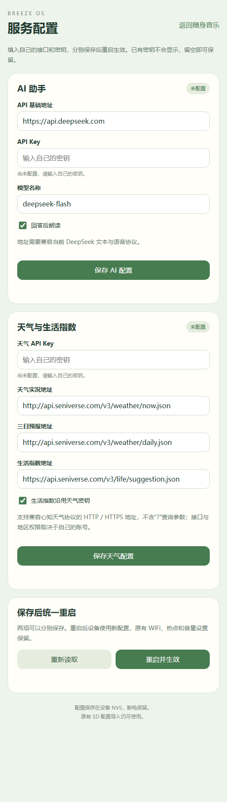

# 当前版本：Breeze OS 1.28.0

在设备热点网页底部进入“服务配置”（默认 `http://172.31.42.1/settings`），填写自己的 AI、天气与生活指数地址和 Key，分别保存后重启即可使用。配置在 NVS 中，修改不需要重新编译；原 SD JSON 一次性导入兼容。

- AI 配置基础地址、模型、Key 与朗读；天气配置实况、预报和指数端点，指数可共用或独立 Key。
- 已有 Key 不回显，空 Key 保留保存值。两个表单分别保存，最后显式重启启用；失败保留原配置。
- 配置写入只用于设备热点接口，检查 Host、Origin 和页面令牌；更新繁忙时拒绝保存/重启。状态响应不含密钥。
- 生活指数缓存带配置来源标记，更换地址或 Key 后重新请求。
- 默认 `BREEZE_GENERIC_BUILD=ON`，忽略本地私有 WiFi 默认值；API Key 只从运行时提供。日常应用 OTA 保留设备已有 NVS。

相关入口：`src/ServiceConfigWeb.cpp`、`src/service_config_page.h`、`src/AiConfig.cpp`、`src/WeatherConfig.cpp`、`src/LifeData.cpp`、根 CMake。更换服务仍要求请求/响应协议兼容；网易云公开端点在 `src/OnlineMusic.cpp`，不由天气配置改变。

当前源码保留中文城市输入、40种天气图标、四排 Space/CN-EN 键盘、显式歌曲下载、双轴/双击唤醒、相册按行读取、六款游戏、背单词与完整缓存语音。更多界面和操作见[使用指南](USER_GUIDE.md)。

## 验证范围

13组功能主机检查通过，包含真实 HTTP/cJSON/NVS 配置模块、实际网页 JS、空 NVS/无 SD 配置、空 Key 保留、异常与繁忙拒绝，以及原音乐、天气/指数、AI/语音、相册和更新回归。ESP-IDF 5.5.6 构建与最终 ELF 的 TLS、Space、PSRAM预算、空 WiFi 默认值检查通过；已生成应用不含维护者的 API Key。主机预算不表示运行时实际空闲内存。

用户已确认网页使用已有地址、Key 留空，分别保存并重启后天气、生活指数和 AI 正常。更换全新 Key/端点和空 NVS 新板首次配置尚无单独用户实机确认；示例图片来自生产 HTML 和合成状态，不是设备拍照。

本公开仓库只保留当前一个源码快照，并提供[当前通用固件 ZIP](../firmware/README.md)与[首次烧录教程](FIRST_FLASH.md)；不累积旧版固件或完整 SD 素材。原理图、PCB外观和原实机演示保留原文件；录像不代表拍摄了本版所有新功能。配置与首次烧录/日常 OTA 的区分见[部署](GETTING_STARTED.md)与[API 教程](API_CONFIGURATION.md)。

## 仓库同步检查（2026-11-17）

公开导出源码在不含真实配置的目录完成 ESP-IDF 5.5.6 干净构建；最终 ELF 的 TLS、Space、PSRAM预算及通用 WiFi 初始值检查通过，应用不含维护者的天气/AI Key。321处公开文档链接无断链，1188份源码/资源/测试与私密版相同（仅两处未启用的旧服务主机名替换为占位符）。原理图、PCB图与实机演示字节保持不变。

Python完整回归共53项，52项通过；桌面视频转换取消用例在 Windows 清理临时文件时遇到 WinError 32。相同问题在原1.26.3快照重现，相关转换代码本次未修改，记录为既有问题；不将这轮回归写成全部通过。该用例属于电脑素材工具，设备网页配置另由上述13组功能检查和用户确认记录覆盖。
