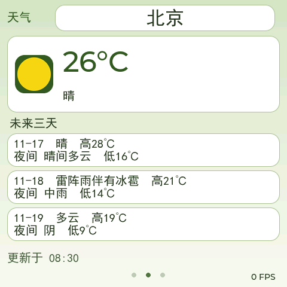
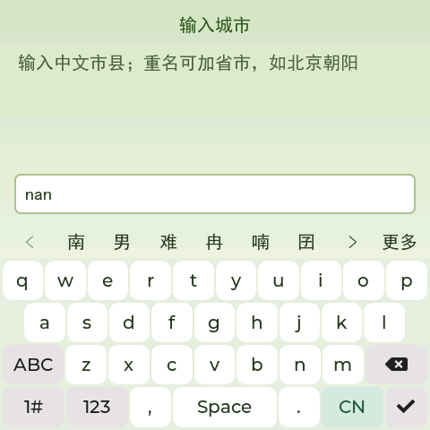
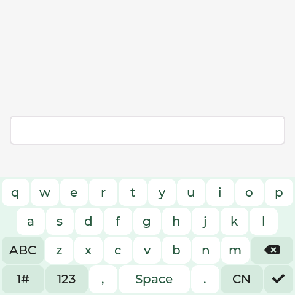
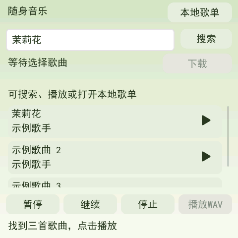

# 图片来源与确认范围

当前源码版本1.28.0。除实机演示录像及封面外，界面图为真实生产LVGL在主机上加载配套字库后渲染，使用合成日期、歌曲、网络和状态数据。没有用图像生成模型替换界面，也不是设备实拍。主机截图中的内存、版本示例等不能当作该设备实时测量。

## 当前功能图

| 图片 | 含义与来源 |
|---|---|
| [games.png](images/games.png)、[gomoku.png](images/gomoku.png) | 当前六款游戏入口和11×11五子棋。 |
| [tile-match.png](images/tile-match.png)、[tile-match-progress.png](images/tile-match-progress.png) | 当前100张随机错位散牌、按真实事件消除18张后的画面。 |
| [alarm.png](images/alarm.png)、[alarm-options.png](images/alarm-options.png)、[alarm-ringing.png](images/alarm-ringing.png) | 当前手动单闹钟、滚动选项和全局响铃提示。模块画面保持当前实现。 |
| [voice-female.png](images/voice-female.png)、[voice-male.png](images/voice-male.png) | 当前音色选择与保存。 |
| [wifi-saved.png](images/wifi-saved.png)、[wifi-switching.png](images/wifi-switching.png) | 当前已保存网络和切换状态，SSID是测试样例。 |
| [settings.png](images/settings.png)、[system-info.png](images/system-info.png) | 当前设置菜单；系统信息使用合成1.28.0应用描述，内存值为示例。 |
| [font-symbols.png](images/font-symbols.png) | 16/20/32px的~·《》字形与位图主机验证。 |
| [ai-cache-speed.png](images/ai-cache-speed.png)、[ai-cache-speed-long.png](images/ai-cache-speed-long.png) | 当前缓存大小/百分比、均速与耗时；使用合成故事与读数，非实拍、非测速证据。 |

其余主页、应用、日历、词卡、媒体、网页和开机图片沿用仍适用的模块示例。GIF含预览停留，不表示设备帧率。系统更新ota-ready.png仍是较早版本号的示例，只说明入口，不对应下载包。文件格式、尺寸与SHA-256见[图片清单](images/manifest.json)。

## 已确认与未单独确认

用户确认：显示/触摸更流畅，男女声切换与重启保留，短句和故事播报正常，手动闹钟的倒计时/息屏唤醒/响铃/停止，随机三消布局、点击与返回。AI设闹钟、八网络完整切换、卡上缓存文件删除、五子棋和奖励牌完整对局、词卡续学及新符号在设备上的显示没有单独确认记录；相应主机检查不能代替这些实机结论。

## 实机录像与硬件

[约42秒实机录像](videos/breeze-os-demo.mp4)和[封面](videos/breeze-os-demo-poster.jpg)保留用户原始演示范围，公开副本为H.264/AAC。它展示外观、开机、桌面及触摸，不代表本次所有新增功能都在该录像出现。原始来源、转换与校验见[录像清单](videos/manifest.json)。

[PCB外观图](images/pcb-3d-2026-11-15.png)是提供的3D渲染原图；[原理图PDF](../hardware/SCH_Schematic2_2026-11-13.pdf)与渲染页面未修改电路。详见[硬件说明](HARDWARE.md)及[硬件清单](../hardware/manifest.json)。这两类资料与UI主机图分开标注。

[首页](../README.md) · [使用指南](USER_GUIDE.md) · [当前能力](WHATS_NEW.md)

语音补充：1.25.3的267KiB/s有串口计时记录；1.25.4约285KiB/s是用户反馈的界面读数。两者包含的等待阶段不同。新图只说明操作位置，不能用其267/1024等示例数字证明1.25.4性能。

## 当前界面补充

<table>
<tr><td width="300"></td><td width="300"></td></tr>
<tr><td align="center">天气与三日预报</td><td align="center">中文城市输入</td></tr>
</table>
<table>
<tr><td width="300"></td><td width="300"></td></tr>
<tr><td align="center">可见Space与CN/EN</td><td align="center">当前歌曲旁下载按钮</td></tr>
</table>

这些图片来自当前生产LVGL与合成测试数据，不是设备实拍。城市重名、天气全部40代码、夜间长城市名和系统信息亦重新渲染。系统信息的内存读数为测试数据，不能拿来计算设备实际PSRAM余量。原实机演示视频与原理图/PCB外观保持原文件，不表示录像重新拍摄了所有新增功能。

手机点歌图 mobile-music.png 来自本版 src/music_web_page.h 的原始嵌入HTML，在540px宽浏览器中使用合成歌曲/播放状态渲染，未调用真实服务；示范当前歌曲旁的下载按钮。

## 网页服务配置

`service-config.png` 是当前 `src/service_config_page.h` 原始 HTML 的540px宽主机渲染，使用合成未配置状态，没有真实密钥或网络服务调用。系统信息图已用本版1.28.0版本夹具重新渲染，内存数字仍为测试数据。其余沿用图展示未改变的操作位置，不能据图判断当前实际服务状态。

用户实机确认：网页保留地址和空 Key，分别保存 AI 与天气配置，重启后天气、四项指数和 AI 正常。新 Key/新端点替换、新板首次配置未单独用户实机确认。原视频、PCB图和原理图未重新生成。
