# 使用指南

这份说明对应 **Breeze OS 1.28.0（青禾）**，固件运行在 **ESP-IDF 5.5.6**。本公开仓库已提供对应的最新原生 IDF 源码和占位符配置；从[编译部署](GETTING_STARTED.md)与[自己的 API 配置](API_CONFIGURATION.md)开始。仓库提供[当前通用固件和首次烧录教程](FIRST_FLASH.md)，完整 SD 素材需另行准备，功能范围见[当前摘要](WHATS_NEW.md)。

设备界面是当前生产 LVGL 在主机上、用合成数据渲染的，不是实机拍照。手机网页截图来自本地示例页面。GIF 含预览停留，不能证明实机帧率；项目没有给出实测最高帧率。

<p align="center">
<a href="images/boot-breeze.gif">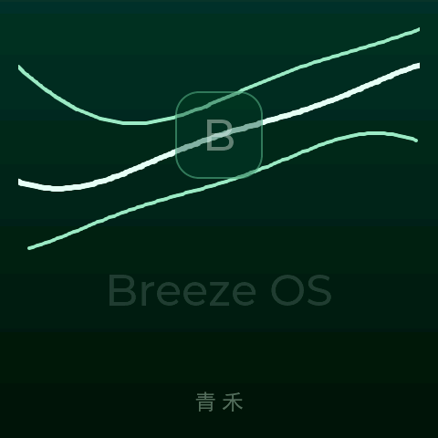</a>
</p>

[API 配置与自己的密钥](API_CONFIGURATION.md) · [编译部署](GETTING_STARTED.md) · [返回项目首页](../README.md) · [更新摘要](WHATS_NEW.md) · [硬件连接表与原理图](HARDWARE.md) · [图片来源与版本范围](SCREENSHOTS.md)

## 手机配置自己的 AI 与天气

<p align="center"><a href="images/service-config.png">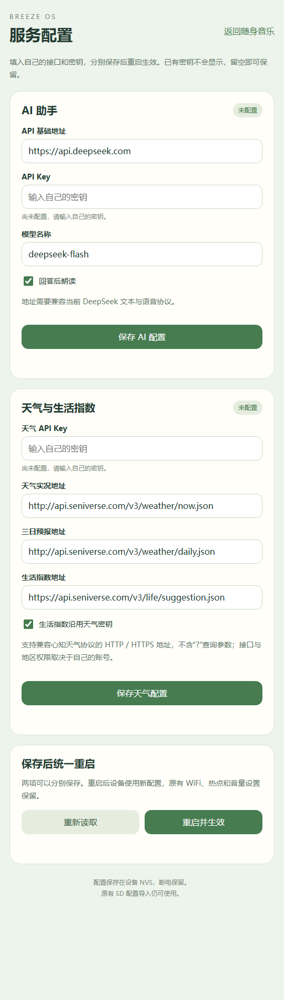</a></p>

1. 从设备顶部下滑，开启热点；长按热点查看名称、密码和访问网址。
2. 手机连该热点，用浏览器打开设备显示的网址，点击页面底部“服务配置”，也可在地址后加 `/settings`。
3. AI 卡填自己的基础地址、Key 和模型，选择是否朗读；天气卡填实况、三日预报、生活指数端点和 Key。生活指数默认共用天气 Key，也可使用独立 Key。
4. 两张卡分别点保存，确认成功后点“重启并生效”。原 Key 不会显示出来；已配置时留空可保留原 Key。
5. 设备重新连网上游后，检查主界面天气/指数和 AI 问答。若有权限或接口错误，核对自己的账号权限与接口协议；换地址并不自动适配另一种 JSON。

网页保存无需 SD；语音完整缓存、字体与音乐仍需 SD。SD 导入成功会删去 `config/ai.json` / `weather.json`，配置已存 NVS，因此重启不丢；示例文件会保留。网页修改不会回写电脑配置，别再次导入旧 JSON 覆盖新设置。详见[字段、地址和导入格式](API_CONFIGURATION.md)。

上图是本版实际 HTML 的主机截图，合成未配置状态。用户已确认保留地址、Key 留空保存和重启后各服务正常；更换全新 Key、新板首次配置没有单独实机确认。

## 1. 开机前准备

自己接线或制作硬件时，先看[完整硬件连接表](HARDWARE.md)和[两页原理图 PDF](../hardware/SCH_Schematic2_2026-11-13.pdf)。表中分别列出 GPIO 与插座脚号，并说明屏幕 / TF 共用引脚、功放跳线和供电标注差异。图纸标为 N8R8，当前 16 MB Flash 固件配置不能直接套用到 8 MB 板子。

1. 硬件搭配：ESP32-S3 N16R8、ST7701 RGB 480 方屏、GT911、MPU6050、MAX98357A、FAT32 SD 卡。
2. 写入与该硬件匹配的 IDF 固件。字体、图标、壁纸、输入法词库、背单词资源和媒体要单独拷到 SD，不随 Git 提供。
3. 打开设置，连接 2.4 GHz Wi‑Fi 并保存。凭据在 NVS 里，掉电还在。
4. 开启热点，手机进入网页“服务配置”，填写自己的 AI、天气与生活指数地址和 Key，分别保存后重启。配置保存在 NVS，不需编译或依赖旧服务器。

开机画面在字库加载前用固件内置字形画出 B、风线和「青禾」，初始化结束后再播放约 3 秒。这一段不读取 SD 上的开机字体。用户已确认青禾、线条和约 3 秒时长。

SD 卡根目录直接放下面这些文件夹，不要再套一层 `sd_card_files`：

~~~text
/
├─ fonts/chinese_16.bin、chinese_20.bin、chinese_32.bin
├─ fonts/cet4_20.bin          背单词专用字库
├─ words/cet4.bwv             4377 条四级词库
├─ ime/pinyin_full.txt
├─ icons/
├─ wallpapers/
├─ imges/                     照片 BIN（目录拼写保持不变）
├─ music/                     WAV 和同名 LRC
└─ videos/                    RVF 和同名 WAV
~~~

系统字体为16/20/32的LVGL v8 BIN，补字后的文件包含「：」「~」「·」「《」「》」。`fonts/cet4_20.bin` 只给背单词用，打开该应用时加载，不替换 `chinese_20.bin`。游戏图标和红色「词」图标已经编进固件，不用再往 `icons` 里传这两张图。TTF 不进仓库。

从 Arduino 分区迁过来，或全新板第一次使用，要先完成与 IDF 匹配的 bootloader 和分区烧录。之后的日常升级只替换应用。应用 OTA 不会把 `words/cet4.bwv` 和 `fonts/cet4_20.bin` 写到 SD。

## 2. 桌面、排序与返回

<table>
<tr>
<td width="300"><a href="images/home.png">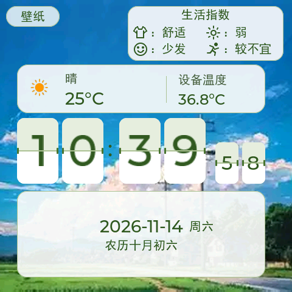</a></td>
<td width="300"><a href="images/apps.png">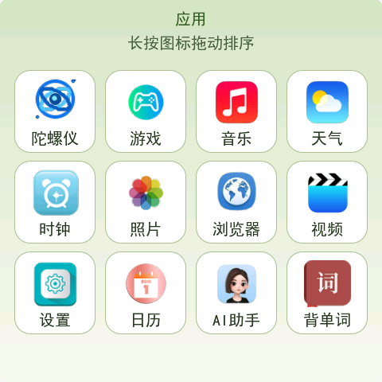</a></td>
</tr>
<tr>
<td align="center">主页</td>
<td align="center">十二个应用</td>
</tr>
<tr>
<td width="300"><a href="images/clock.gif"></a></td>
<td width="300"><a href="images/depth.gif">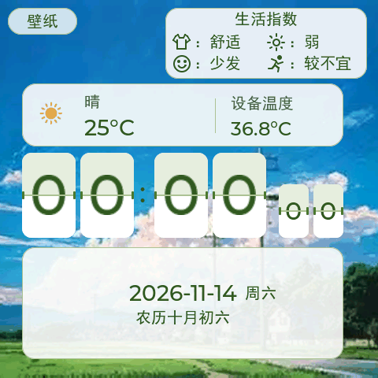</a></td>
</tr>
<tr>
<td align="center">数字钟翻页保持原效果</td>
<td align="center">约 180 ms 层叠侧滑，仅桌面与进出应用</td>
</tr>
</table>

横向滑动切换主页和应用页。数字钟继续翻页，不跟着页面被拆开。

长按图标约半秒，保持按住并拖到目标位置，松手后按稳定应用 ID 保存排序。旧顺序里分开的 2048 和平衡球会收成一个「游戏」入口。下图为拖动状态：

<p align="center">
<a href="images/drag.png">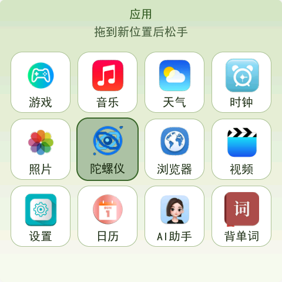</a>
</p>

从屏幕左缘或右缘向内侧滑动约一指宽，松开后返回。只有这三类动作使用约 180 ms 的层叠侧滑和接触阴影：桌面横滑、从桌面进入应用、从应用回到桌面。打开应用之后，里面的页面立即切换。页面准备过久时，固件会改为直接显示。用户已确认切换明显更顺。主机 GIF 含预览停留，内存不足时也会改成瞬时切换。

## 3. 快捷面板

<table>
<tr>
<td width="300"><a href="images/quick-panel.png">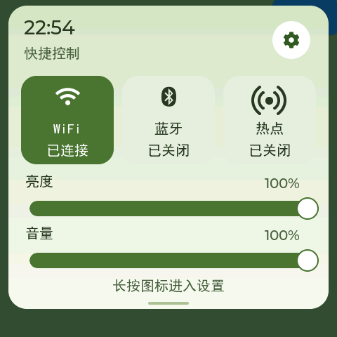</a></td>
<td width="300"><a href="images/settings.png">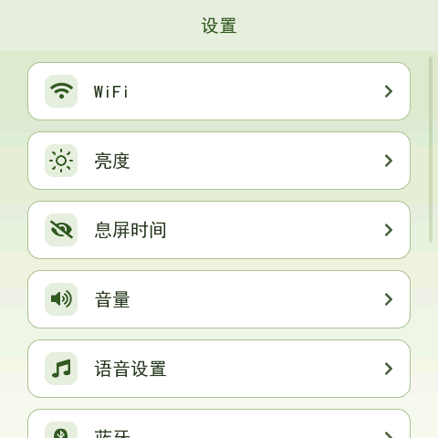</a></td>
</tr>
<tr>
<td align="center">下拉后的开关和滑条</td>
<td align="center">设置应用中的各项入口</td>
</tr>
</table>

从顶栏向下拉出面板。

- 短按 Wi‑Fi、BLE 或热点：立刻开关。
- 长按同一项：进入对应设置。
- 拖动亮度、音量滑条：马上生效。

BLE 只提供 GATT，不能接收手机的经典蓝牙音乐。

## 4. 日历与四项指数

<table>
<tr>
<td width="300"><a href="images/calendar.png">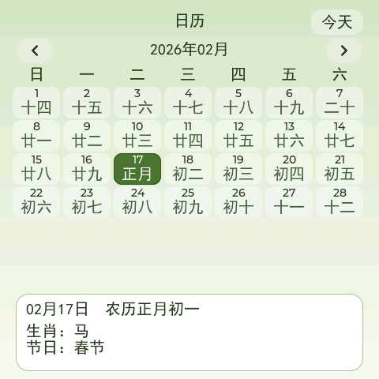</a></td>
<td width="300"><a href="images/home.png"></a></td>
</tr>
<tr>
<td align="center">选中一天看农历</td>
<td align="center">衣着、紫外线、感冒、运动</td>
</tr>
</table>

主页在公历右侧显示中文星期，农历在下一行居中；节气和节日仅在当天有内容时出现。点进日历后：

1. 点某一天，查看农历、生肖、节气和节日。
2. 点击左右按钮，或上下滑动切换月份。

离线数据覆盖 1901–2099。生肖按春节计算，并展示常见节日。这不是法定休息日或调休表。

四项生活指数来自心知天气，需要私有 Key 和互联网，有网时按城市缓存到当天。主页上的设备温度读自 MPU 芯片，不能当成室温。1.17 起天气在后台更新，用户已确认天气显示正常。

## 5. 热点：改名、共享、打开网页

<table>
<tr>
<td width="300"><a href="images/hotspot-editor.png">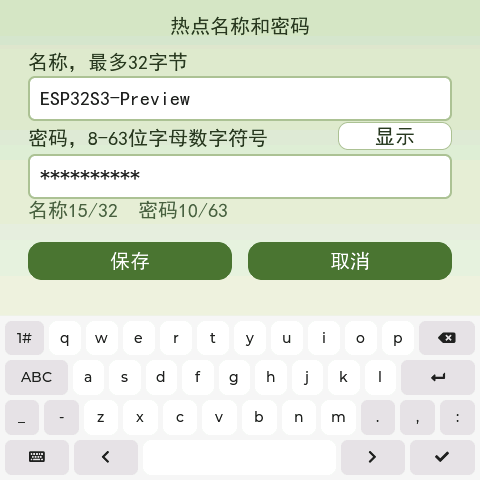</a></td>
<td width="300"><a href="images/settings.png"></a></td>
</tr>
<tr>
<td align="center">名称与掩码密码</td>
<td align="center">在设置中进入热点</td>
</tr>
</table>

热点与上游 Wi‑Fi 可以同时工作，把连接设备热点的手机接入上游网络。上游要是一台独立路由器，或另一部提供网络的手机。只有一块板、没有任何上游时，网页仍可做本地上传，但不能搜歌或使用 AI。

1. 设置 → 热点 → 修改名称和密码。
2. 名称不超过 32 个 UTF-8 字节；密码为 8–63 位可打印 ASCII。
3. 保存。重启后仍然有效。
4. 修改名称或密码后重新连接；同名热点更换密码时，可先忘记旧网络再输入新密码。
5. 用手机浏览器打开设置里显示的地址。常见为 `http://172.31.42.1`，若与局域网冲突，以设置页实际地址为准。

默认名称由 MAC 派生，默认密码为随机 12 位；改过之后以你保存的为准。手机打开的是热点网页，负责搜歌、媒体和固件上传。设备屏幕上的浏览器是另一条路径，见第 9 节。

## 6. AI 与键盘

<p align="center">
<a href="images/ai-keyboard.png">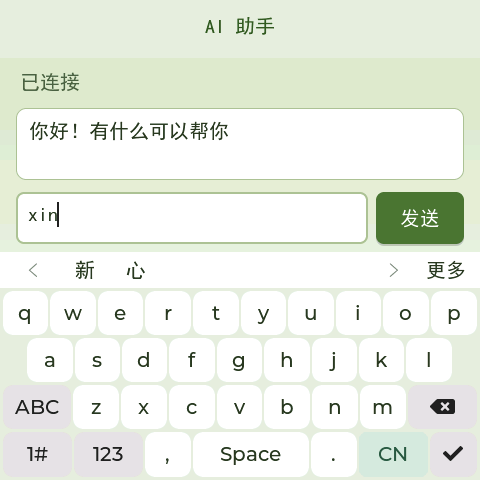</a>
</p>

这是云端对话，不是板子上的本地模型，也没有麦克风语音识别。回答经 HTTPS 来自 DeepSeek，需要可上网的 Wi‑Fi。`speak` 为真时，文字回来后扬声器朗读；朗读失败时文字仍保留。

把下面内容存成 SD 卡 `/config/ai.json` 后开机。校验并写入 NVS 成功后，固件删除该文件；无效则保留文件和原来的配置。也可以用本仓库中的 `scripts/provision_ai.py` 经串口写入（先关掉串口监视器）。网页没有 API Key 编辑框。请只在本地保存自己的 Key，不提交到公开仓库。NVS 未加密，含 NVS 的备份请当私有文件保管。

```json
{
  "version": 1,
  "api_base": "https://api.deepseek.com",
  "api_key": "YOUR_API_KEY",
  "model": "deepseek-flash",
  "speak": true
}
```

使用：

1. 打开 AI，点问题框。键盘固定在底部，拼音候选在键盘上方，问题框和「发送」并排在候选栏上面。
2. 底行 **CN / EN** 切换中文拼音和英文直输。ABC / abc 仍切换大小写。热点密码保持英文、数字和符号。
3. 中文模式下输入拼音再点候选。`nihao` 可以先选「你」，后面的 `hao` 还在，再选「好」。这是按拼音逐字上屏，候选来自 SD 上的 `/ime/pinyin_full.txt`。
4. 候选栏左右翻页每次 6 个字。「更多」展开后每页最多 24 个字，可翻页或收起。没有匹配时不再留着上一组字。
5. 输入例如「用一句话介绍 ESP32-S3」，点发送。
6. 点键盘收起键，或从侧边返回，可收起键盘并保留未发送文字。再从侧边返回一次，退出 AI。

四排 QWERTY 底部的 **Space** 每次输入一个空格；CN/EN 切换语言，123 和符号页仍可切换。

<table>
<tr><td width="300"><a href="images/keyboard-space.png">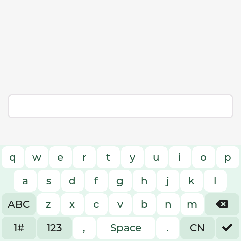</a></td><td width="300"><a href="images/keyboard-candidates.png">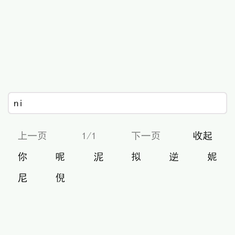</a></td></tr>
<tr><td align="center">大按键与底部空格</td><td align="center">拼音更多候选</td></tr>
</table>

同一套键盘也用于本机音乐、媒体改名和热点名称。用户已确认候选展开和中英文切换。没有 SD 词典时，部分页面只有少量备用候选。完整中文城市输入需要更新 20/32 px 字库和完整拼音词库，步骤见[资源部署](FONTS_AND_MOTION.md)。

「搜歌 ……」「播放第 N 首」、暂停和音量由本机解析，不发给大模型。语音接口为 DeepSeek TTS，24 kHz PCM。401表示鉴权失败，402表示余额不足，429表示限流，5xx表示服务异常；错误不会清空已显示的文字。当前请求包含所需鉴权头。

### 完整缓存与音色

文字返回后，状态栏显示“缓存”大小或百分比、均速（KiB/s）和已用秒数。均速从进入缓存阶段计算，包含建连、服务端等待、接收与写卡，不是网络瞬时峰值；没有新数据时均速会降低。整段音频接收并完成SD校验后关闭HTTP，从本地文件播放。长故事仍需等待完整生成；没有可写SD、空间不足或中断时保留文字并提示。

<table>
<tr><td width="300"><a href="images/ai-cache-speed.png">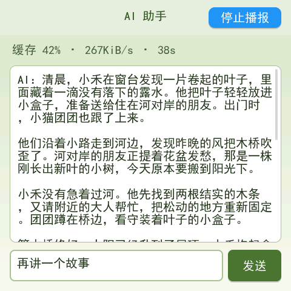</a></td><td width="300"><a href="images/ai-cache-speed-long.png">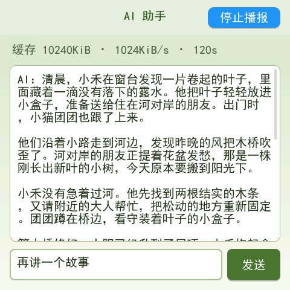</a></td></tr>
<tr><td align="center">百分比、均速和耗时</td><td align="center">未知总长度时显示缓存大小</td></tr>
</table>

缓存时临时关闭WiFi Modem省电，完成、失败或停止后尝试恢复原模式。恢复失败会重试并记录错误；没有永久关闭WiFi省电，也没有关闭蓝牙或热点。

用户报告当前版本可用，屏上均速约285KiB/s。这个读数不是对应串口抓包，也没有相同文本的前后对照；具体效果取决于网络和云端生成。[当前实现与确认范围](RELEASE_V1.28.0.md)

缓存仅为 `/.cache/breeze-ai-speech.pcm` 一个临时文件，上限24 MiB。结束、取消或失败后尝试删除，开机清理断电残留。存储卡故障仍可能影响播放或清理。缓存和播放时均可点“停止播报”。

进入“设置 → 语音设置”选择女声或男声，点保存，后续回答生效，重启保留。

<table>
<tr><td width="300"><a href="images/voice-female.png">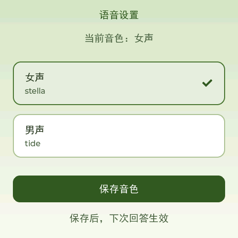</a></td><td width="300"><a href="images/voice-male.png">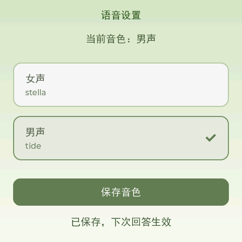</a></td></tr>
<tr><td align="center">女声 stella</td><td align="center">男声 tide</td></tr>
</table>

故事可要求完整经过与结尾；普通回答上限1024 tokens，故事/详细/继续为2048 tokens。设备仅保留上一轮普通问答，输入“继续”可承接，重启清空；模型决定实际文字长度。用户已确认短句和故事播报正常。

AI的明确闹钟指令由本地处理，例如“帮我设置明天8点的闹钟”“20分钟后提醒我”“查看闹钟”。详见[时钟的使用](#13-闹钟)。没有新增麦克风语音识别。

## 7. 背单词

<table>
<tr>
<td width="300"><a href="images/word-match.png">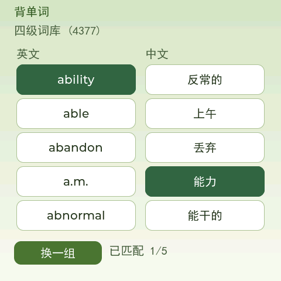</a></td>
<td width="300"><a href="images/word-match-complete.png">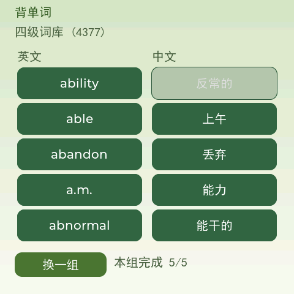</a></td>
</tr>
<tr>
<td align="center">两列打乱，点英文或中文</td>
<td align="center">本组完成后可换一组</td>
</tr>
</table>

应用页上是红色「词」图标。英文和中文分成两列，各自打乱。可以先点英文再点中文，也可以先点中文。配对正确变为绿色并锁定；点错会短暂变红，然后可以重选。「换一组」加载下一组。侧边向内滑返回桌面。

- 词库为 4377 条四级条目，按索引读取，不会把整本词库常驻内存。
- 每组最多 5 对，同一组里的英文和中文释义都不重复。
- 遇到与本组已有词相同的释义时，当前组在该词之前结束，这个词进入下一组，避免词被跳过。
- 完成一组后保存下次开始的位置。重新进入或重启可以接着学。一组还没完成时，换组不会立刻把进度写成新的起点。
- 释义按提供的文本显示，固件不改正拼写。

按[背单词资源生成说明](WORD_MATCH.md)从仓库词表生成两个运行文件，再复制到SD根目录，保留卡上已有文件：

~~~text
words/cet4.bwv
fonts/cet4_20.bin
~~~

缺少文件时，应用会提示路径并可以重试。复制后插回卡并重启。这两个文件不能靠 OTA 安装。

主机测试覆盖了全部词条的分组、打乱、对错锁定、换组、续学和缺文件重试。设备上的配对和续学操作还没有单独的确认记录。

## 8. 游戏

应用页打开“游戏”，六款均离线运行。小游戏内侧边返回游戏列表，列表内侧边返回桌面。游戏图标内置于固件，不需要复制到SD。

<p align="center"><a href="images/games.png">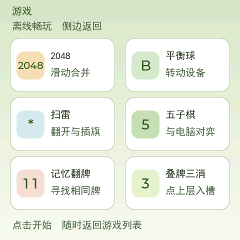</a></p>

| 游戏 | 操作 |
|---|---|
| 2048 | 滑动合并。刚合成的方块不会在同次移动再次合并，Restart重开。 |
| 平衡球 | 转动设备让球进入目标，“校准中心”按当前角度重设；离开时暂停。 |
| 扫雷 | 8×8、10颗雷。点按翻开，长按插旗，或使用标记模式；首击与周边安全。 |
| 五子棋 | 11×11，玩家黑棋先手，电脑白棋；横竖斜五连及以上获胜，无禁手。电脑回合不能连点，重开重新下。 |
| 记忆翻牌 | 4×4、8对。每次翻两张，相同锁定，不同盖回。 |
| 叠牌三消 | 100张随机散牌，99张普通牌+1张奖励牌；只点未受上方遮挡的牌，三张相同消除。7格槽满则失败，清空牌面与槽获胜。 |

<table>
<tr><td width="300"><a href="images/gomoku.png">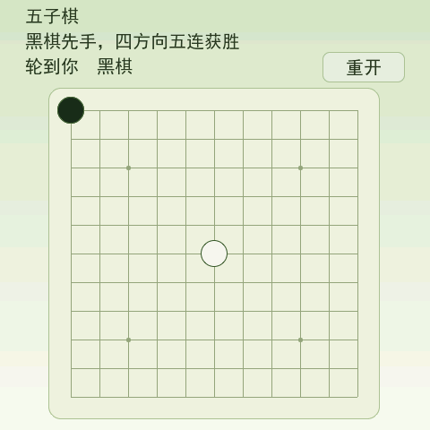</a></td><td width="300"><a href="images/tile-match.png">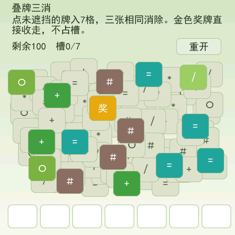</a></td></tr>
<tr><td align="center">五子棋：黑棋先手</td><td align="center">三消：随机错位交叠</td></tr>
</table>
<table>
<tr><td width="300"><a href="images/tile-match-progress.png">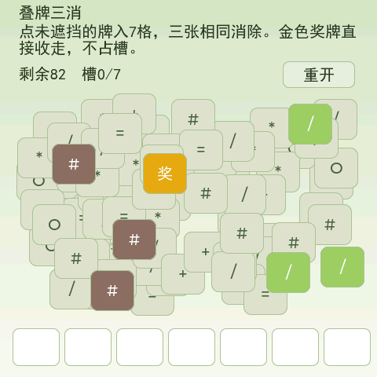</a></td><td width="300"><a href="images/memory.png">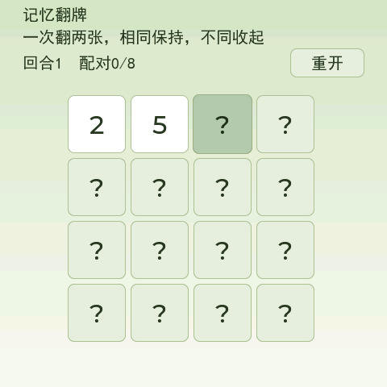</a></td></tr>
<tr><td align="center">消除后露出下面的牌</td><td align="center">记忆翻牌</td></tr>
</table>

三消中，彩色牌可选，被挡住的牌为灰绿；金色“奖”牌直接收取、不占槽。重开后位置重新变化，构造发牌保证存在通关路径，但随意选择仍可能满槽。无需联网、SD游戏素材或额外模型。

随机布局、点击和侧边返回已有用户实机确认；五子棋胜负、电脑挡棋、奖励牌与满槽规则有主机检查，尚无单独的完整对局确认记录。

## 9. 设备浏览器与随身音乐

<table>
<tr>
<td width="300"><a href="images/browser.png">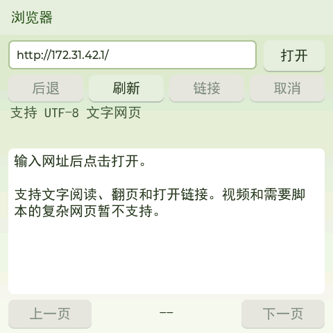</a></td>
<td width="300"><a href="images/native-music.png">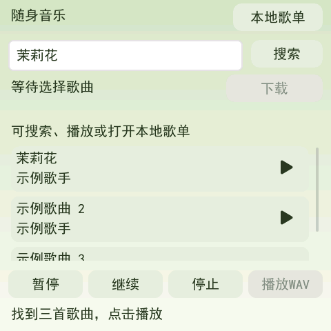</a></td>
</tr>
<tr>
<td align="center">新进入时地址为 172.31.42.1</td>
<td align="center">点「打开」后的随身音乐</td>
</tr>
</table>

浏览器顶部不另设「本机音乐」快捷按钮。打开「浏览器」后：

1. 新进入或退出后重新进入时，地址栏为 `http://172.31.42.1/`。第一次进入不会自动请求。
2. 保留这个地址，或改成 `http://127.0.0.1/`、`http://localhost/`，再点「打开」。这里的 127.0.0.1 指设备自己。
3. 热点已经打开时，热点设置里显示的本机根地址同样进入随身音乐；设备当前 Wi‑Fi 地址的 HTTP 根页也会识别。
4. 打开这一页不要求热点开着，也不要求上游网络已经连上。
5. 其他主机、路径、端口以及 HTTPS 仍走原来的文字浏览器。

随身音乐是已知本机音乐功能的屏幕控件：搜索、选择、播放、暂停、继续、停止，以及点击下载保存 WAV / LRC。它不执行任意网页脚本，也不播放网页视频。抖音这类站点不在范围内。

<p align="center">
<a href="images/native-music-saved.png">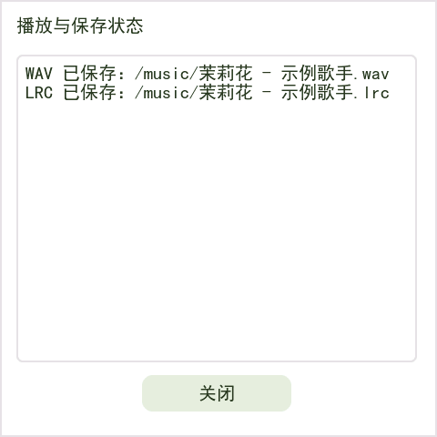</a>
</p>

联网搜索需要设备以站点方式连上能上网的 Wi‑Fi。播放、缓存和保存都需要可用的 SD 卡；只搜索时不写卡。播放只用临时 MP3，点当前歌曲旁“下载”才保存到歌单。文件为：

- `/music/歌名 - 歌手.wav`（44.1 kHz、立体声、16 位 PCM）
- `/music/歌名 - 歌手.lrc`

平台没有歌词时只保存 WAV，不会编造 LRC。保存可能要几分钟，以页面上的 WAV 和歌词结果为准。退出本页不会主动停掉正在播放或保存的歌。停止会取消尚未完成的准备和保存。

侧边返回先收起键盘，再从随身音乐回到浏览器。浏览器有历史时先回前一网页，没有历史时回桌面。本地歌单仍可从音乐页进入。

用户已确认：本机页可以打开并搜索，选择当时有音源的版本后可以播放并保存。

### 搜到不等于能播

搜索结果来自平台公开接口。一条结果只说明目录里有这个条目，不说明当前接口能给出可播放音频，也不表示会员曲库可用。工程不登录账号，不绕过访问限制，也不会在失败后自动改成其他歌手。

当前把下面几类分开提示：

| 情况 | 界面含义 |
| --- | --- |
| 音源不可用 | HTTP 404/410，或 HTTP 200 却返回 HTML/JSON 错误内容；选中的版本保持不变 |
| 访问受限 | HTTP 403，平台拒绝访问音源 |
| 格式或大小 | 不是当前支持的 MP3 响应，或超过 20 MiB 缓存上限 |
| 网络 | 连接或读取失败 |
| SD | 卡不可用、空间不足或缓存写入失败 |

当前已核对的例子：邓紫棋《唯一》（来源 ID 2083785152）搜索得到结果后，接口转到 HTML 错误页，因此这一条原曲不能播放。可以手动改选其他有音源的版本，或用手机热点网页上传自己的 MP3。分类后的新提示已在主机上核对，设备上尚未单独确认。

## 10. 手机网页上的音乐、照片与视频

<table>
<tr>
<td width="300"><a href="images/mobile-music.png">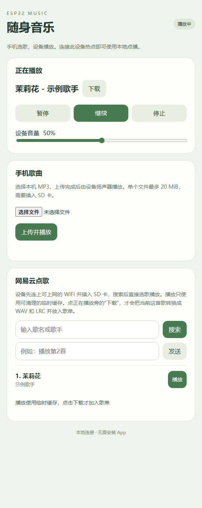</a></td>
<td width="300"><a href="images/playlist.png">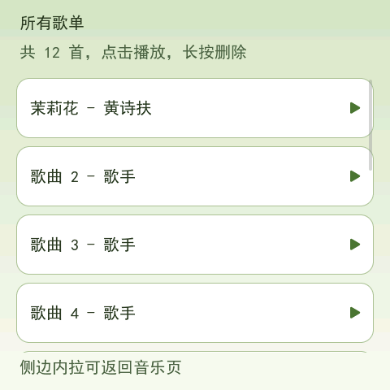</a></td>
</tr>
<tr>
<td align="center">手机网页：搜索；点击下载才保存 WAV 与 LRC</td>
<td align="center">设备歌单：点按播放，长按确认删除</td>
</tr>
<tr>
<td width="300"><a href="images/mobile-media.jpg">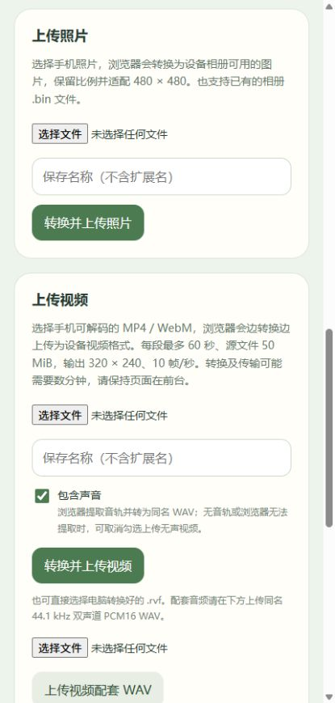</a></td>
<td width="300"><a href="images/media-list.png">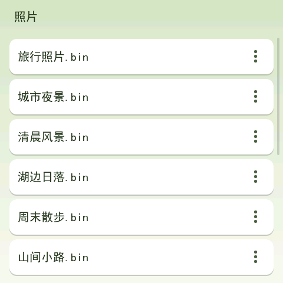</a></td>
</tr>
<tr>
<td align="center">浏览器转换后再上传</td>
<td align="center">设备上的照片与视频</td>
</tr>
</table>

手机先连接设备热点，再打开设置中的地址。网页上的音乐有两种操作：

1. **播放手机文件**：在「手机歌曲」选择 20 MiB 以内 MP3，点击「上传并播放」。设备从缓存解码播放，该入口不会自动生成歌词。
2. **在线点歌并存到 SD**：输入歌名或歌手搜索，点击结果旁「播放」只缓存播放。需要加入歌单时，再点「正在播放」旁的「下载」。音源限制与上一节相同。
3. 等待出现 WAV/LRC 保存路径，再点击「播放已保存的 WAV」；下次也可从设备本地歌单离线播放。

音乐页 PREV（上一首）左侧是「所有歌单」。点按播放；长按并确认后，删除这一对 WAV 和 LRC。网页音乐是设备自己的文件，不会镜像另一部手机里正在播放的 App。

照片与视频：

<table>
<tr>
<td width="300"><a href="images/media-rename.png">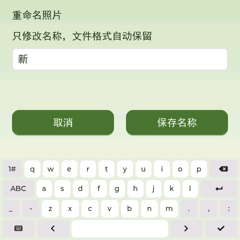</a></td>
<td width="300"><a href="images/media-menu.png">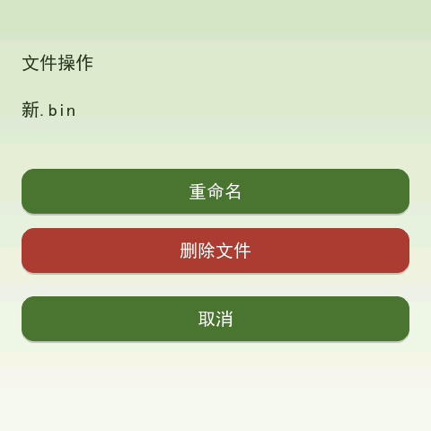</a></td>
</tr>
<tr>
<td align="center">长按，用拼音改名</td>
<td align="center">右侧竖点，确认后删除</td>
</tr>
</table>

照片：JPEG、PNG 或 WebP，不超过 25 MiB。浏览器转成 480 方形 BIN 再上传。 设备兼容 `/imges` 与 `/images` 目录；打开时优先预加载，整图内存不足则按行读取，切图/返回释放已加载图片。照片恢复与反复打开已有用户实机确认。

视频：MP4 或 WebM，不超过 50 MiB，时长不超过 60 秒。浏览器转成 320×240、10 fps 的 RVF，并可带同名 WAV，默认含声音。转换可能要几分钟，请保持页面在前台。浏览器解不了时，用电脑生成 RVF 和 WAV 再上传。

原始 JPEG/PNG 或 MP4 放进 SD 后不能直接播放，必须是转换后的 BIN / RVF。同名文件会保留旧内容；要替换请先改「保存名称」。

在设备上长按照片或视频，用拼音改名。点右侧竖点并确认即可删除；视频会一并处理对应的 WAV。

## 11. 系统更新

<table>
<tr>
<td width="300"><a href="images/mobile-ota.jpg">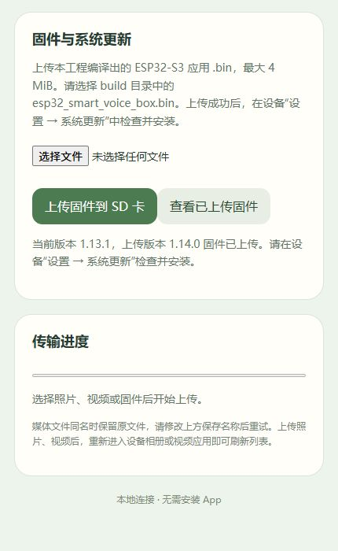</a></td>
<td width="300"><a href="images/ota-ready.png">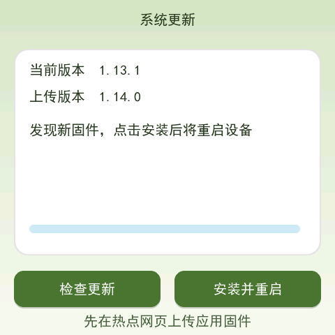</a></td>
</tr>
<tr>
<td align="center">网页只接收应用 bin</td>
<td align="center">旧示例：当前 1.13.1，候选 1.14.0</td>
</tr>
</table>

1. 在网页选择不超过 4 MiB 的**应用** bin。不要选择 bootloader、分区表或合并后的整片镜像。
2. 上传完成后，文件在 SD 上等待，不会马上安装。
3. 设备上打开「设置 → 系统更新」，点击「检查更新」，再点击「安装并重启」并确认。
4. 重启后保持供电和 SD 卡，界面与音频任务正常运行约 20 秒后确认新固件；确认前启动异常时，支持回滚的引导程序可恢复上一份有效固件。

设备不会自己到网上查找新固件，只检查 SD 里的候选包。截图里的 1.13.1 和 1.14.0 是旧界面示例，用来说明检查和安装的位置。当前介绍对应的系统是 Breeze OS 1.28.0。设置里的系统信息读取正在运行的版本。已经在 IDF 分区上运行的设备，日常不要整片擦除。公开仓库不提供这些 bin。

## 12. 息屏与唤醒

<p align="center">
<a href="images/screen-timeout.png">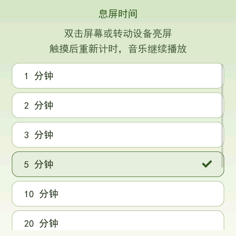</a>
</p>

在设置里选择 1、2、3、5、10、20、30、60 分钟，或永不。计时从最后一次触摸重新开始。屏幕关闭后，双击或转动设备（IMU）即可唤醒，亮度恢复为熄屏前的数值。

## 13. 闹钟

<table>
<tr><td width="300"><a href="images/alarm.png">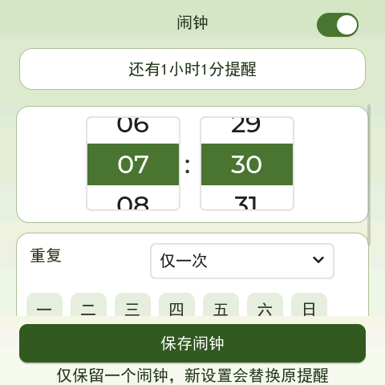</a></td><td width="300"><a href="images/alarm-options.png">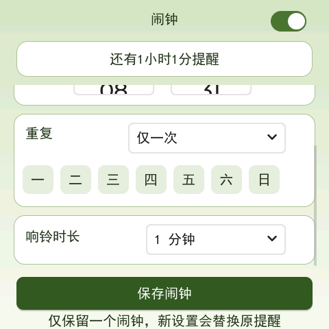</a></td></tr>
<tr><td align="center">选择小时和分钟，查看倒计时</td><td align="center">向下滑设置重复与响铃时长</td></tr>
</table>

1. 打开“时钟”，滚动选择24小时制的小时和分钟。
2. 选择仅一次、每天、周一至周五或自选星期；自选可勾选多个星期。
3. 向下滑设置响铃1～60分钟，右上开关选择是否启用，点击“保存闹钟”。修改开关同样要保存。
4. 顶部显示已保存闹钟距下次提醒的时间。只保留一个闹钟，新设置替换旧设置。

<p align="center"><a href="images/alarm-ringing.png">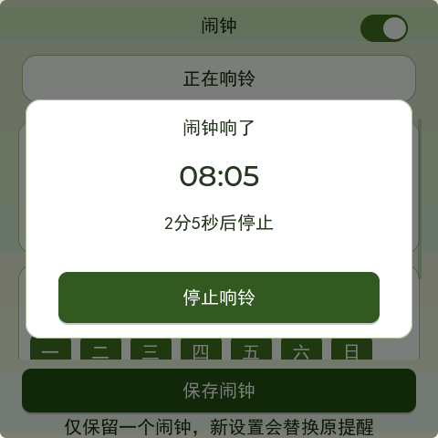</a></p>

响铃自动唤醒屏幕，点“停止响铃”结束本次；达到设置时长也会停止。一次性闹钟触发后关闭，重复闹钟保留后续日期。声音使用当前音量，音量0时不出声。没有可用SD铃声文件时使用内置提示音。

仅一次手动设置为下一个对应时间；在AI中明确“明天8点”可指定明天。“工作日”为周一至周五，不计算调休。设备需保持供电，断电不能响铃；重启后建议联网校时。手动设置、倒计时、唤醒、响铃和停止已实机确认；AI指令单独验证仍待完成。

## 14. WiFi保存与切换

<table>
<tr><td width="300"><a href="images/wifi-saved.png">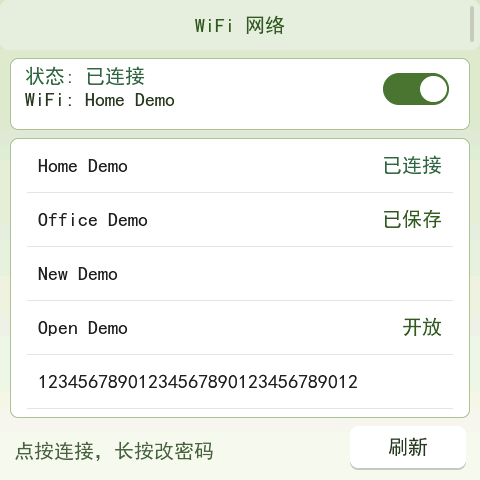</a></td><td width="300"><a href="images/wifi-switching.png">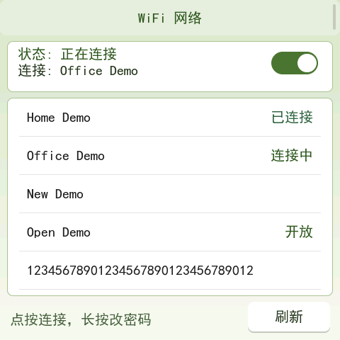</a></td></tr>
<tr><td align="center">最多保存8个成功网络</td><td align="center">短按保存项切换</td></tr>
</table>

进入“设置 → WiFi”扫描。首次网络输入密码，取得该网络IP后才保存；保存过的网络短按直接尝试连接。短按当前网络保持连接，长按可重新输入密码。离线时自动寻找可见的已保存网络，用户关闭WiFi后停止自动连接。只支持2.4GHz。多路由切换的完整实机确认仍待完成。

## 15. 字库补符号

`~·《》`已补入16/20/32字号的配套字库，原有字符保留；设备使用的是SD卡BIN。字符表是仓库的 `font_assets/extra_symbols.txt`，生成步骤见[字库说明](FONTS_AND_MOTION.md)。已有配套BIN和TTF时运行脚本，复制三个文件到SD `/fonts/` 后重启；补字不需要刷固件。生成BIN、ZIP和TTF不随Git提供。

<p align="center"><a href="images/font-symbols.png">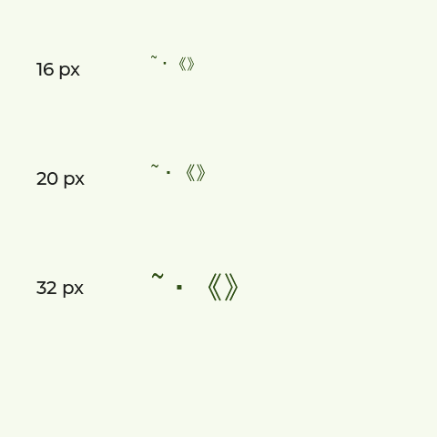</a></p>

## 常见问题

- **搜不到 Wi‑Fi**：板子只有 2.4 GHz。保存后再看是否连上。
- **手机网页打得开，歌和 AI 不行**：先确认热点的上游真的能上网。本地上传不需要外网。
- **设备上打不开随身音乐**：使用 `http://172.31.42.1/`、`http://127.0.0.1/` 或 `http://localhost/` 的根地址并点「打开」。其他网站仍是文字浏览。
- **只有搜索、不能播放**：看提示是音源、访问受限、网络还是 SD。可换一个有音源的版本，或上传自己的 MP3。
- **背单词提示缺文件**：把 `words/cet4.bwv` 和 `fonts/cet4_20.bin` 放到 SD 根目录对应文件夹后重启。
- **天气空白、AI 不回答**：天气 Key 要在编译私有配置里；AI 要成功导入 JSON。两者都没有网页编辑器。
- **文字是方块**：界面字体检查 SD 上含「：」「·」的 LVGL v8 BIN。开机「青禾」不依赖这三份系统字库。词条缺字时检查 `fonts/cet4_20.bin`。
- **新文件没盖掉旧文件**：同名会留下旧的，请更改保存名称。
- **蓝牙已配对但喇叭无声**：没有 A2DP。请用本机歌单或网页保存到 SD 的 WAV。

更短的导览见仓库根目录的 README。当前根目录即为本指南对应的原生 IDF 源码。


## 16. 天气、中文城市与双轴唤醒

<table>
<tr><td width="300"><a href="images/weather.png">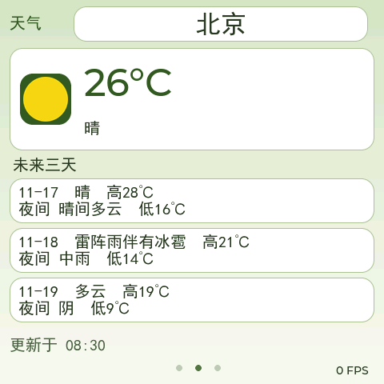</a></td><td width="300"><a href="images/weather-night.png">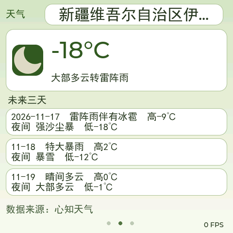</a></td></tr>
<tr><td align="center">当前天气与三日预报</td><td align="center">夜间图标与长城市名</td></tr>
</table>

桌面左右滑到天气页，点击顶部城市，用中文拼音输入城市或县区。比如“南宁”“四川五通桥”“北京市朝阳区”；重名时补全省市再确认。也支持原拼音或 V3 ID。图标随返回天气码选择，已内置全部 0～38、99 共40种，不需要往SD上传天气图片。

<table>
<tr><td width="300"><a href="images/city-input.png">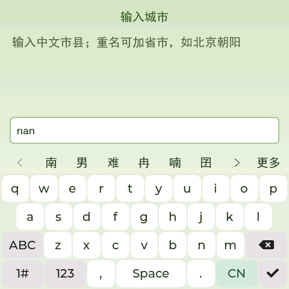</a></td><td width="300"><a href="images/city-ambiguous.png">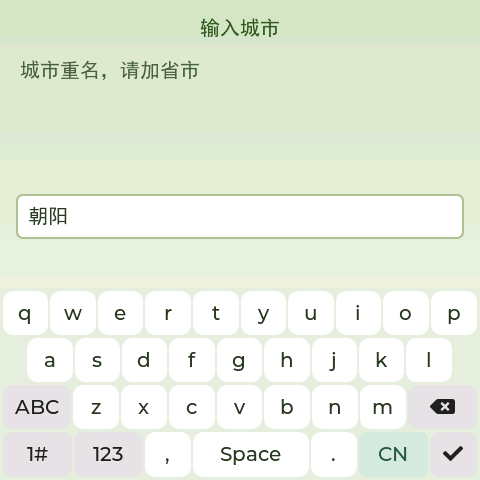</a></td></tr>
<tr><td align="center">中文键盘输入城市</td><td align="center">重名时补充省市</td></tr>
</table>

城市目录采用官方3239条国内位置记录；字库覆盖与目录收录不增加Key的接口/地点权限。继续使用原天气实况API；权限不足时显示错误，不切换整点实况接口。天气设置需要自己的心知Key，见[API配置](API_CONFIGURATION.md)。

设置息屏时间后按触摸空闲计时。息屏后双击，或向前后/左右倾转唤醒；只比较ROLL/X和PITCH/Y角速度，忽略YAW/Z。阈值合成0.525rad/s（约30.1°/s），持续60ms，刚息屏600ms不触发。该门槛是角速度而非累计倾角。用户已确认双轴判断和双击均正常。
