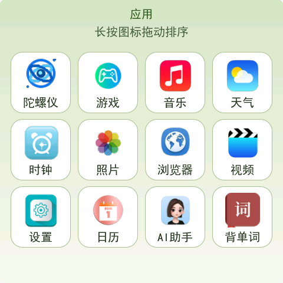
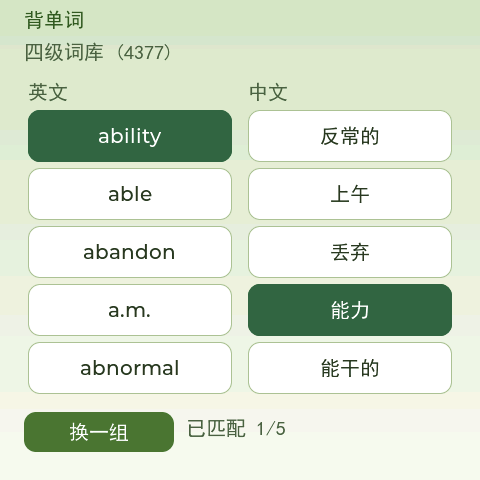

# 背单词 · 中英文卡片配对

在应用页打开“背单词”（红色“词”图标）。英文和中文卡片分别打乱排列，先点一张英文，再点对应中文，也可以先选中文。匹配正确会标绿并锁定，错误会短暂提示后允许重选。“换一组”加载下一组词，侧边向内滑动返回桌面。

一组最多 5 对，同组排除重复的英文和中文释义。词库释义按用户提供的文本保留，不自动校正拼写或释义。

完成一组后保存下次开始的位置，重新进入或重启后可接着学习；未完成时换组不会立即保存。遇到相同释义会在它之前结束当前组，让该词进入下一组，保证词库中的条目都能出现。

以下为生产代码的主机渲染预览：





## SD 卡文件

将资源包中的两个文件夹复制到 SD 卡根目录，保留卡上已有文件：

```text
SD 卡根目录/
  words/
    cet4.bwv
  fonts/
    cet4_20.bin
```

`cet4.bwv` 包含 4377 条词汇，应用按索引读取当前组，不将整份词库常驻内存。`cet4_20.bin` 是覆盖词库全部释义的专用 20 px 中文字库，仅在应用打开时加载。原有 `chinese_20.bin` 等系统字库无需替换。

OTA 只更新固件，不能自动安装这两个 SD 文件。复制文件后插回 SD 卡并重启。缺少文件时，应用会提示路径并提供重试。两个新图标已内置于固件，不需要复制图标文件到 SD 卡。

## 更新词库

源文件为 UTF-8 编码；每行“英文 + 至少两个空格（或制表符）+ 中文释义”，例如：

```text
ability  能力
able  能干的
```

```powershell
python scripts/convert_word_book.py --input assets/words/cet4.txt --font-symbols .tools/cet4-symbols.txt
```

安装 Node.js/npm，准备工程使用的 `simhei.ttf` 或自行选择包含所需汉字的字体后，生成专用字库：

```powershell
$wordFontSymbols = Get-Content -LiteralPath '.tools/cet4-symbols.txt' -Raw -Encoding UTF8
npx --yes lv_font_conv --font simhei.ttf --size 20 --bpp 4 --format bin --no-kerning --symbols $wordFontSymbols --output sd_card_files/fonts/cet4_20.bin
```

转换器保留原文、不静默截断。英文最多 47 个 UTF-8 字节，中文释义最多 127 个 UTF-8 字节。新增汉字后重新生成 20 px、4 bpp LVGL 二进制字库；当前包已覆盖全部提供的词汇。TTF 与生成 BIN 不随 Git 提交。将两个生成文件复制到前述 SD 路径，重启后使用。

## 文件格式 BWV1

24 字节小端头：`BWV1`、条目数、索引位置（24）、数据位置、数据字节数、保留值（0），后接 `条目数 + 1` 个 uint32 相对偏移。每条为 `英文 UTF-8 + NUL + 中文 UTF-8 + NUL`。固件校验文件大小、索引范围、记录长度和 UTF-8，文件缺失或损坏时返回错误。

图标原图保存在 `assets/icon_sources/game.png`、`assets/icon_sources/english.png`。1.20.1 起游戏图标使用去掉外围白底的 `assets/icon_sources/game-transparent.png`，保留圆形内部的白色手柄。可使用 `scripts/convert_app_icons.py --icon ... --name ... --c-output ... --symbol ...` 转换为固件中的 64×64 RGB565+alpha 图片，保留颜色与透明度。
